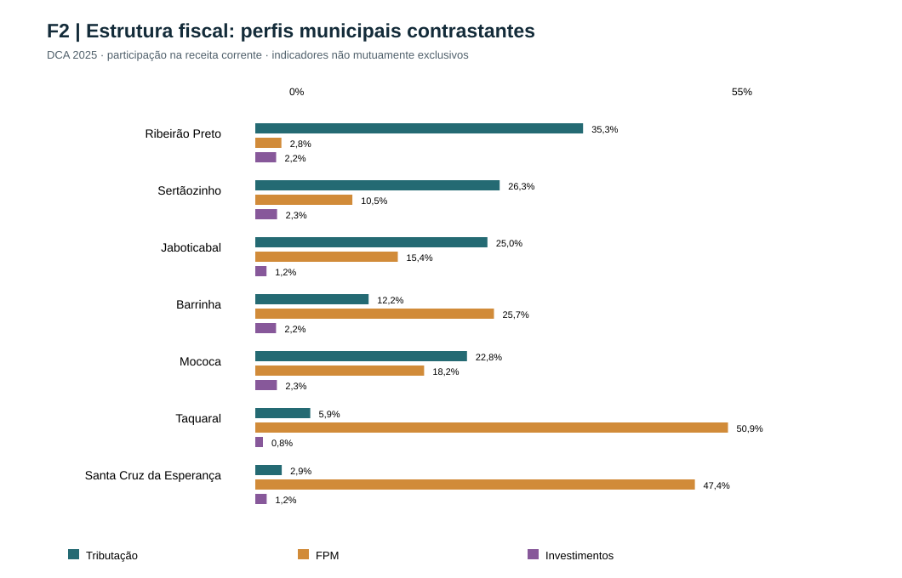
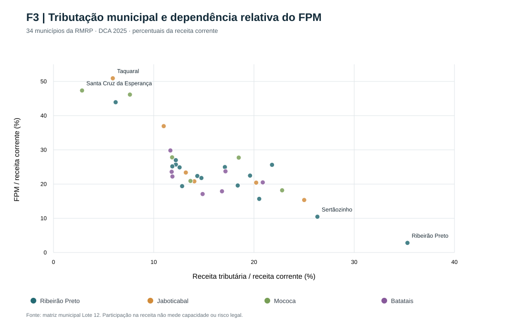
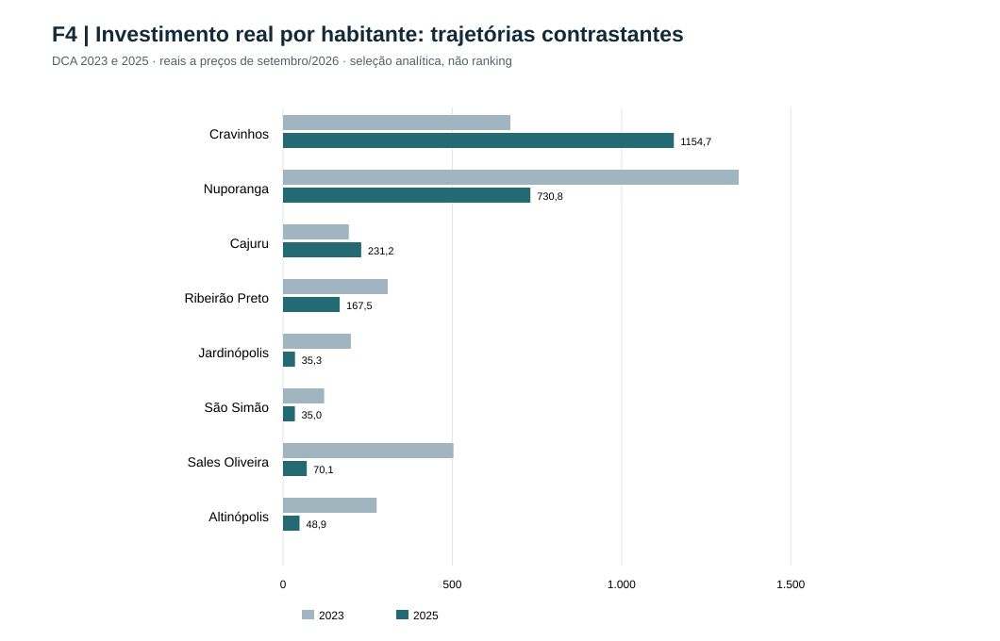

# Finanças municipais da Região Metropolitana de Ribeirão Preto — Volume II
## Desigualdades fiscais, condições institucionais, cenários 2027–2030 e estratégias territoriais

**Oitava versão de trabalho — Lote 63 (02/11/2026).**
**Situação:** integração editorial dos Lotes 46, 48, 49 e 61A. As matrizes municipais ISS–ICMS estão consolidadas sem duplicação; o efeito líquido do IBS continua indeterminado. Documento não homologado.

### Resumo executivo

O conjunto de 34 municípios da Região Metropolitana de Ribeirão Preto apresenta uma combinação de expansão da receita corrente real por habitante e contração recente dos investimentos. A receita corrente real per capita aumentou nos 34 municípios entre 2015 e 2025; a variação metropolitana agregada foi de 39,86%. Já o investimento real liquidado per capita recuou em 31 municípios entre 2023 e 2025, com redução agregada de 39,52%. Os dois movimentos referem-se a períodos distintos, não identificam causalidade e não demonstram, isoladamente, indisponibilidade financeira.

A composição da arrecadação é assimétrica. Em 2025, a tributação equivalia a 25,44% da receita corrente do conjunto metropolitano, mas a mediana entre municípios era de 14,2019%; o FPM equivalia a 12,84% no agregado, contra mediana municipal de 22,9286%. Esses contrastes indicam que a estrutura do município típico difere da estrutura do agregado metropolitano e que a discussão sobre autonomia tributária precisa considerar porte e base econômica. A análise das quatro sub-regiões é igualmente heterogênea.

O arcabouço fiscal estabelecido pela LC 200/2023 incide diretamente sobre os orçamentos federais em seu campo normativo, e não cria por si um teto municipal. Eventuais efeitos sobre os municípios exigem demonstração dos canais de repasse, financiamento e execução. A reforma tributária do consumo, por sua vez, requer análise de transição normativa e de repartição de receitas, sem projeções genéricas de ganhos ou perdas municipais.

Os cenários adverso, de continuidade e favorável para 2027–2030 permanecem condicionais. A grade metodológica documenta 408 registros municipais e 60 agregados territoriais, mas os valores futuros não foram preenchidos arbitrariamente. A comprovação de persistência externa do pacote computacional do Lote 35 permanece pendente.

### Critérios de leitura

As partes abaixo foram consolidadas **sem supressão do conteúdo substantivo dos quatro documentos originais**. Conservam-se suas ressalvas e eventuais repetições que serão eliminadas somente na etapa de revisão editorial. O material deve ser interpretado como manuscrito integrado para exame, não como versão final.

- **Fontes e deflação:** DCA/FINBRA e demais bases arquivadas pelo projeto; comparações reais a preços de setembro/2026, utilizando média mensal anual do IPCA para fluxos; per capita com população do ano.
- **Agregações:** razões metropolitanas e sub-regionais são calculadas entre somas; medianas caracterizam a distribuição municipal.
- **Limites:** razões de despesas correntes/receita corrente não são margem financeira nem indicadores legais DTP/RCL. RGF/RREO contém lacunas e os índices anômalos de Pontal permanecem segregados.
- **Causalidade:** retração de investimentos e evolução de arrecadação não são atribuídas automaticamente ao arcabouço fiscal ou à reforma tributária.
- **SWOT:** oportunidades e ameaças externas não comprovadas não são inventadas; recomendações aparecem separadamente.
- **Aparato gráfico:** as figuras previstas estão indicadas nos pontos pertinentes, mas não se afirma que gráficos e mapas tenham sido renderizados ou incorporados como arquivos.

### Sumário

1. Parte I — Diagnóstico fiscal e desigualdades territoriais
2. Parte II — SWOT orientadas pela transição ISS–IBS, pelo arcabouço federal e pela exposição municipal
3. Parte III — Arcabouço federal e reforma tributária
4. Parte IV — Cenários condicionais 2027–2030
5. Roteiro das figuras e mapas
6. Fontes internas, verificação e pendências de homologação

---

# Parte I — Diagnóstico fiscal e desigualdades territoriais

*Texto integrado do documento-fonte [CAPITULO_DESIGUALDADES_FISCAIS_SUBREGIOES_LOTE46.md](CAPITULO_DESIGUALDADES_FISCAIS_SUBREGIOES_LOTE46.md); estado e ressalvas originais preservados.*

**Data:** 02/11/2026. **Estado:** capítulo analítico candidato ao Volume II, não homologado. **Fontes internas:** síntese Lote 32, análises sub-regionais de 2025, Lote 28 (perfis históricos), Lote 31 (trajetórias individuais) e revisão municipal Lote 45. Sem extração de novos dados.

## 1. Introdução: o agregado metropolitano não representa o município típico

A Região Metropolitana de Ribeirão Preto reúne 34 municípios distribuídos nas Sub-regiões de Ribeirão Preto (15), Jaboticabal (6), Mococa (6) e Batatais (7). O exame de sua situação fiscal exige distinguir três planos: (i) indicadores metropolitanos, construídos pela razão entre somas contábeis; (ii) distribuição entre municípios, descrita por medianas e contrastes; e (iii) trajetórias históricas de cada ente. A razão agregada é influenciada pelo peso dos municípios de maior arrecadação e não expressa a experiência de uma municipalidade de porte pequeno ou médio.

O crescimento da receita corrente real por habitante entre 2015 e 2025 ocorreu nos 34 municípios, mas não significa que todas as municipalidades aumentaram na mesma medida sua capacidade de investimento. Entre 2023 e 2025, 31 registraram retração real do investimento liquidado por habitante. São intervalos e indicadores distintos; não é admissível deduzir causalidade direta ou atribuir o comportamento à LC 200/2023.

## 2. Expansão real das receitas e heterogeneidade sub-regional

| Recorte | Variação real da receita corrente per capita 2015–2025 | Receita corrente real per capita 2025 (R$ set./2026) | Variação real do investimento per capita 2023–2025 |
|---|---:|---:|---:|
| Sub-região de Ribeirão Preto | +36,06% | 7.541,85 | −35,83% |
| Sub-região de Jaboticabal | +49,20% | 7.436,57 | −50,96% |
| Sub-região de Mococa | +47,22% | 6.854,98 | −18,30% |
| Sub-região de Batatais | +48,44% | 8.418,05 | −51,77% |
| RMRP | +39,86% | 7.559,46 | −39,52% |

**Leitura:** a Sub-região de Batatais reúne a maior receita corrente real por habitante de 2025 e a maior retração do investimento per capita entre 2023 e 2025. Essa combinação impede identificar receita por habitante com execução automática de obras. A Sub-região de Mococa registrou o menor nível de receita per capita, mas a retração menos intensa do investimento no mesmo intervalo. A Sub-região de Jaboticabal apresentou expansão da receita per capita próxima à de Batatais, acompanhada de queda relevante do investimento. A Sub-região de Ribeirão Preto combinou crescimento menos intenso da receita per capita com maior concentração tributária agregada.

Todos os valores reais decorrem de fluxos anuais ajustados pelo IPCA de média dos doze meses, expressos a preços de setembro de 2026, e denominadores populacionais correspondentes aos exercícios. Não se devem intercambiar razões nominais e variações reais.

## 3. Estrutura de financiamento corrente e diferenciação territorial

| Recorte | Tributação/receita | ISS/receita | IPTU/receita | FPM/receita | Despesa corrente liquidada/receita | Investimento liquidado/receita |
|---|---:|---:|---:|---:|---:|---:|
| Sub-região de Ribeirão Preto | 28,89% | 10,76% | 9,55% | 9,13% | 88,87% | 2,54% |
| Sub-região de Jaboticabal | 19,24% | 5,74% | 7,60% | 20,31% | 91,21% | 2,08% |
| Sub-região de Mococa | 17,27% | 5,08% | 7,03% | 24,06% | 85,48% | 2,63% |
| Sub-região de Batatais | 16,33% | 4,78% | 4,27% | 20,17% | 89,27% | 3,08% |
| RMRP | 25,44% | 9,06% | 8,53% | 12,84% | 88,93% | 2,55% |

**Nota:** 2025, razões entre somas nominais de municípios, não médias ou medianas municipais. Tributação, ISS e IPTU se sobrepõem em termos de contas agregadas e não podem ser somados entre si. A participação do FPM é apenas uma parcela das transferências. A diferença entre despesa corrente liquidada e receita corrente bruta não corresponde a caixa livre, resultado primário ou margem legal.

A Sub-região de Ribeirão Preto apresenta maior peso da receita tributária, do ISS e do IPTU na estrutura agregada. Seu resultado não pode ser automaticamente generalizado para os 15 municípios, pois a concentração da base econômica e tributária é heterogênea. No extremo oposto, a Sub-região de Mococa mostra a maior proporção agregada de FPM; isso permite formular análise de sensibilidade às regras e aos fluxos de transferências, mas não autoriza presumir redução dos repasses federais.

A maior razão entre despesa corrente liquidada e receita corrente bruta ocorre na Sub-região de Jaboticabal (91,21%), que também registra a menor relação investimento/receita (2,08%). Esses resultados descrevem a composição contábil e demandam exame de execução, vinculações e disponibilidades financeiras. Não configuram por si prova de insolvência ou descumprimento da LRF.

## 4. Composição municipal: por que não basta comparar médias

**Figura F2 — Indicadores de composição fiscal em municípios selecionados, 2025.** Percentuais da receita corrente; tributação, FPM e investimentos são indicadores distintos, não parcelas exaustivas de uma mesma decomposição.

**Figura F3 — Relação entre participação tributária e participação do FPM, 34 municípios, 2025.** As cores identificam as quatro sub-regiões; o gráfico não representa limites legais nem previsão de exposição ao IBS.

A distribuição municipal apresenta contrastes mais expressivos do que os agregados. Em 2025, Ribeirão Preto registrava participação tributária de 35,31% da receita corrente e FPM de 2,81%; Taquaral, 5,92% e 50,92%, respectivamente; Santa Cruz da Esperança, 2,85% e 47,35%; Serra Azul, 6,20% e 43,92%. Não se trata de notas de mérito arrecadatório: a diferença entre proporções reflete porte, estrutura econômica, regras de transferência e composição das demais receitas.

A mediana municipal em 2025 foi de 14,2019% para tributação/receita corrente e 22,9286% para FPM/receita. Os valores diferem do agregado metropolitano de 25,44% e 12,84%. A divergência decorre da ponderação implícita nas somas contábeis, evidenciando que a composição do município típico não equivale à composição do conjunto metropolitano.

Entre 2015, 2019, 2023 e 2025, 20 de 34 municípios permaneceram no mesmo quadrante segundo os limiares fixos de tributação e FPM definidos pela mediana de 2025. Onze mudaram entre os extremos 2015 e 2025; os restantes podem ter mudado em intervalos intermediários e retornado. A leitura requer cautela: mudar de quadrante é alteração da proporção relativa observada, não classificação automática de melhoria ou deterioração fiscal.

## 5. Investimentos: nível, intensidade e trajetória

**Figura F4 — Investimentos reais por habitante em municípios contrastantes, 2023 e 2025.** Valores em reais a preços de setembro de 2026; seleção descritiva de oito municípios, não ranking metropolitano.

O investimento liquidado representava 3,73% da receita corrente agregada metropolitana em 2015, 3,48% em 2019, 4,94% em 2023 e 2,55% em 2025. A trajetória não é monotônica. A inflexão recente não deve ser confundida com série de perda contínua desde 2015.

Em 2025, Cravinhos apresentava investimento equivalente a 12,43% da receita corrente e aumento real per capita de 71,93% entre 2023 e 2025. Nuporanga exibia proporção de 6,56% e investimento real de R$ 730,83 por habitante, embora com redução de 45,71% no período. Jardinópolis registrava apenas 0,52% da receita corrente e queda real per capita de 82,37%; São Simão, 0,40% e queda de 71,18%. Esses exemplos demonstram que nível, intensidade e variação temporal constituem dimensões distintas do investimento.

A comparação de investimentos liquidados com receitas de capital ou transferências de capital não demonstra, por si, financiamento de obras individualizadas. O pré-inventário do Lote 37 identifica fluxos agregados, mas não vincula despesas e receitas a projetos, convênios e cronogramas. A ausência desse vínculo impede inferências sobre quais programas explicam o comportamento observado.

## 6. Implicações por sub-região

### Sub-região de Ribeirão Preto
A interpretação deve ser bifocal: a composição agregada revela forte participação tributária, mas municípios como Serra Azul, Barrinha e Pontal exibem perfis de FPM e receita tributária bastante diferentes do polo. A agenda é identificar o peso do centro regional e as restrições dos municípios periféricos sem atribuir ao conjunto um único padrão de autonomia. Ribeirão Preto, Sertãozinho e Cravinhos também têm trajetórias de investimento distintas.

### Sub-região de Jaboticabal
O padrão agregado de maior razão de despesa corrente e menor investimento/receita exige investigação de custeio e do ciclo de obras. Jaboticabal, individualmente, registra relação de despesas correntes liquidadas/receita corrente superior a 100% em 2025, mas isso não comprova déficit orçamentário. Taquaral apresenta elevada participação do FPM, evidenciando divergência dentro da mesma sub-região.

### Sub-região de Mococa
A maior participação regional do FPM deve ser decomposta entre municípios, especialmente Cássia dos Coqueiros e Santa Cruz da Esperança, com proporções elevadas de transferências constitucionais. Cajuru e Santa Rosa de Viterbo aumentaram o investimento real per capita entre 2023 e 2025, contrastando com a queda regional agregada. A combinação de heterogeneidade interna e dependência relativa do FPM demanda cenários não uniformes.

### Sub-região de Batatais
A maior receita real por habitante do agregado e a maior proporção investimento/receita em 2025 coexistem com redução intensa do investimento real per capita. Nuporanga manteve nível per capita de investimento relativamente elevado apesar da queda; Sales Oliveira registrou retração de 86,07%. Uma inferência única sobre capacidade de investimento encobriria essas diferenças.

## 7. Consequências para os cenários fiscais de 2027–2030

Os resultados não justificam projetar automaticamente para 2027–2030 o crescimento real da receita de 2015–2025 ou a contração do investimento de 2023–2025. Os três cenários condicionais já previstos (adverso, continuidade, favorável) devem ser definidos por município, e só depois agregados às quatro sub-regiões e à RMRP. Entradas monetárias só podem ser quantificadas com documentação dos respectivos parâmetros e das fontes de financiamento e investimento.

A LC 200/2023 disciplina o arcabouço federal e não cria teto automático de gasto municipal. Seus possíveis efeitos sobre programas e transferências dependem de mecanismos específicos, não de associação com a retração registrada no investimento municipal. A reforma tributária constitui frente institucional separada, com regras de transição a serem cotejadas com o desenho normativo vigente.

## 8. Limitações, qualidade e incorporação editorial

Os dados principais de receita e despesas de 2025 têm cobertura de 34/34 municípios. Os indicadores RCL/pessoal do RGF possuem cobertura de 26/34 nos recortes examinados; outras rubricas legais e funcionais têm coberturas variáveis. Os índices atípicos de Pontal continuam segregados para QA, e as classificações CAPAG não são convertidas em nota regional. A falta de observação não é tratada como zero.

**Visualizações previstas no corpo do capítulo:** (i) gráfico das receitas reais per capita por sub-região junto à seção 2; (ii) gráfico de composição fiscal junto à seção 3; (iii) dispersão ou distribuição municipal de tributação versus FPM junto à seção 4; (iv) gráfico de investimento real per capita para municípios contrastantes junto à seção 5; (v) mapa municipal de padrões fiscais no ponto de discussão territorial, somente a partir de geometria oficial e CRS validado, sem geração cartográfica por IA. Não produzir atlas avulso.

**Estado da entrega:** narrativa integrada das quatro sub-regiões e da RMRP concluída como versão de trabalho, com dados e conceitos referenciados a documentos anteriores. Pendente homologação editorial, verificação de figuras/tabelas no pacote final e integração com o Volume II completo.

---

# Parte II — SWOT consolidadas com ISS e ICMS observados

**Data:** 02/11/2026. **Estado:** revisão editorial integrada, sem homologação do efeito líquido do IBS. Fontes: Lotes 55, 57, 58, 59. Os fatores fiscais internos são preservados; as duas dimensões tributárias observadas e as ações concretas substituem a repetição de anexos.

## Diretrizes de leitura

O ISS principal e a cota-parte ICMS de 2025 são **rubricas contábeis observadas**, e não a receita média legal de referência, que exige regras e série específicas do art. 115 da LC 227/2026. Não presumir ganho ou perda com IBS. A mudança de regime e a oportunidade legal de conferência/contestação de coeficientes são comuns a todos os municípios; o contexto quantitativo e as prioridades administrativas são próprios. O arcabouço federal LC 200/2023 não cria teto municipal ou corte automático de FPM.

## Síntese metropolitana e sub-regional

A matriz metropolitana e os quatro perfis sub-regionais dos Lotes 55 e 58 permanecem válidos como síntese de composição fiscal e diversidade territorial. A oportunidade comum é acompanhar, conferir e eventualmente contestar os coeficientes oficiais de repartição. Ameaças só podem ser associadas a perdas ou restrições específicas mediante provas adicionais. As ações devem ser dimensionadas conforme a capacidade de cada prefeitura.

## Matrizes SWOT metropolitanas e sub-regionais formalizadas

Data: 02/11/2026. Matrizes agregadas complementares às 34 fichas municipais do Lote 61A. Cada evidência é do agregado indicado, nunca da média municipal. Mecanismos da LC 227/2026 apresentados como condicionais, sem mensuração de ganho/perda IBS.

## RMRP — agregado metropolitano

| Quadrante | Análise | 
|---|---|
| Força interna | Receita corrente real per capita +39,86% em 2015–2025; aumento da participação tributária agregada e série municipal ISS/ICMS preexistente. |
| Fraqueza interna | Investimento real per capita −39,52% em 2023–2025, com retração em 31/34 municípios; heterogeneidade das fontes e do FPM. |
| Oportunidade externa condicional | Transição do IBS, memória da receita de referência e coeficientes oficiais possibilitam ações intermunicipais de conferência e cooperação técnica, sem pressupor benefício líquido. |
| Ameaça externa condicional | Distribuição IBS distinta da configuração de ISS e ICMS vigente e eventual descontinuidade de obras cofinanciadas podem alterar receitas/carteiras, mas os efeitos não estão estimados. |
| Estratégia administrativamente executável | Consolidar painel intermunicipal ISS total e ICMS 2019–2026, apoiar a conferência dos coeficientes divulgados até 2027 e instituir controle de projetos por instrumento e fonte. |

**Controle:** participação contábil de ISS principal e ICMS cota-parte é observada, mas a receita média legal de referência exige ISS total e acessórios, componentes de 2026 e correção nominal legal. Direção e magnitude de IBS futuras indeterminadas.

## Sub-região de Ribeirão Preto

| Quadrante | Análise | 
|---|---|
| Força interna | 15 municípios; ISS principal/receita corrente agregado exige soma dos componentes, não média simples; sub-região registra 28,89% de participação tributária total em 2025. |
| Fraqueza interna | A concentração no município polo e a heterogeneidade dos demais municípios dificultam inferir o perfil de cada ente pelo agregado. |
| Oportunidade externa condicional | O novo sistema IBS prevê rotina de conferência da memória de referência ISS e ICMS e dos coeficientes oficiais, com eventual contestação. |
| Ameaça externa condicional | O critério de repartição e a passagem gradual ao IBS podem modificar a composição de recursos de entes distintos; magnitude e sentido indeterminados. |
| Estratégia administrativamente executável | Organizar painel de ISS principal e ICMS creditado por município (2019–2025), apoiar obtenção de ISS total e base 2026, e preparar conferência conjunta dos coeficientes até 2027. |

**Controle:** participação contábil de ISS principal e ICMS cota-parte é observada, mas a receita média legal de referência exige ISS total e acessórios, componentes de 2026 e correção nominal legal. Direção e magnitude de IBS futuras indeterminadas.

## Sub-região de Jaboticabal

| Quadrante | Análise | 
|---|---|
| Força interna | Receita corrente real per capita +49,20% em 2015–2025 no agregado; perfis municipais de tributação e FPM distintos. |
| Fraqueza interna | Despesa corrente/receita 91,21% e investimento/receita 2,08% em 2025 indicam necessidade de estudar compromissos e fontes, sem representar índices legais de solvência. |
| Oportunidade externa condicional | Regras de repartição IBS e divulgação de coeficientes criam ocasião para coordenação de controles contábeis nos seis municípios. |
| Ameaça externa condicional | Divergência entre recebimentos futuros e obrigações de custeio pode ampliar dificuldades de programação de entes específicos; sem estimativa causal de perda IBS. |
| Estratégia administrativamente executável | Comparar memória ISS/ICMS municipal e fluxos de receita/despesa, priorizando entes com maior comprometimento de custeio e menor capacidade técnica, sem rotular riscos legais. |

**Controle:** participação contábil de ISS principal e ICMS cota-parte é observada, mas a receita média legal de referência exige ISS total e acessórios, componentes de 2026 e correção nominal legal. Direção e magnitude de IBS futuras indeterminadas.

## Sub-região de Mococa

| Quadrante | Análise | 
|---|---|
| Força interna | Receita corrente real per capita +47,22% em 2015–2025; diversidade de bases fiscais entre os seis municípios. |
| Fraqueza interna | FPM/receita de 24,06% e receita real per capita de R$ 6.854,98 no agregado de 2025; FPM não sofre corte automático pela LC 200/2023. |
| Oportunidade externa condicional | A implantação do IBS e a possibilidade legal de conferência/contestação permitem apoio técnico compartilhado aos municípios de menor capacidade fiscal. |
| Ameaça externa condicional | Mudanças na distribuição da receita do IBS e na execução de programas federais podem afetar entes distintos, mas não estão medidas nem vinculadas a projetos individualizados. |
| Estratégia administrativamente executável | Coordenar conciliação ISS total+ICMS creditado 2019–2026, carteira documentada de obras e apoio à conferência de coeficientes; separar FPM constitucional de convênios. |

**Controle:** participação contábil de ISS principal e ICMS cota-parte é observada, mas a receita média legal de referência exige ISS total e acessórios, componentes de 2026 e correção nominal legal. Direção e magnitude de IBS futuras indeterminadas.

## Sub-região de Batatais

| Quadrante | Análise | 
|---|---|
| Força interna | Receita real por habitante de R$ 8.418,05 em 2025; investimento/receita agregado de 3,08%. |
| Fraqueza interna | Investimento real per capita caiu 51,77% de 2023 a 2025, sem causalidade atribuível às normas nacionais. |
| Oportunidade externa condicional | Regras de transição e coeficientes IBS criam janela comum para aprimorar documentação tributária e planejamento plurianual. |
| Ameaça externa condicional | Alterações distributivas não estimadas e descontinuidade de financiamentos específicos podem criar risco de execução de carteira, apenas onde os instrumentos estejam identificados. |
| Estratégia administrativamente executável | Examinar a série ISS+ICMS por ente, distingui-la do volume e temporalidade das obras e instituir controle do coeficiente de repartição, sem extrapolar o agregado para os sete municípios. |

**Controle:** participação contábil de ISS principal e ICMS cota-parte é observada, mas a receita média legal de referência exige ISS total e acessórios, componentes de 2026 e correção nominal legal. Direção e magnitude de IBS futuras indeterminadas.

## Uso editorial

Inserir esta seção ao início da Parte II, seguida das 34 fichas municipais do Lote 61A. Conservar a fonte específica dos dados agregados, não convertê-los em propriedades de todos os municípios. A existência das cinco matrizes não supre auditoria legal e quantitativa dos coeficientes.

---

## As 34 matrizes municipais integradas

### Barrinha

**Situação fiscal observada e exposição inicial:** ISS principal equivale a 4,80%, cota-parte de ICMS a 13,15% e soma contábil a 17,95% da receita corrente em 2025. FPM equivale a 25,72%. Não equivalem à receita média legal.

| Quadrante | Análise e orientação |
|---|---|
| **Força interna** | Receita corrente real por habitante cresceu 47,27% entre 2015 e 2025; o indicador registra tendência, não solvência. |
| **Fraqueza interna** | A receita tributária corresponde a 12,21% da receita e o FPM a 25,72%, sugerindo maior necessidade de distinguir transferências constitucionais de receitas tributárias e voluntárias. |
| **Oportunidade externa** | Transição para IBS e possibilidade legal de conferência da memória de cálculo e contestação fundamentada dos coeficientes. O benefício fiscal eventual não está demonstrado. |
| **Ameaça externa condicional** | A distribuição futura do IBS poderá diferir da composição ISS/ICMS observada, sem direção ou magnitude comprovada. O FPM não sofre corte automático por força da LC 200/2023. |
| **Resposta estratégica prioritária** | Conciliar os dois componentes fiscais, verificando acessórios legais. A unidade municipal de Finanças/Tributos, com o Controle Interno, deve constituir dossiê 2019–2026, acompanhar divulgação dos coeficientes do CGIBS até 31/08/2027 e preparar eventual contestação no prazo previsto em lei. |
| **Produto e monitoramento** | memória documental do ISS e ICMS e ficha de conferência CGIBS; indicadores: exercícios conciliados, divergências identificadas e tempestividade de eventual contestação. |

**Controle de evidências:** sete exercícios com ambos os componentes observados; efeito líquido IBS **indeterminado**.. A participação conjunta observada ISS principal + ICMS não constitui receita média legal nem indicador de ganho/perda futura. Ações de conferência são recomendações, sujeitas à estrutura organizacional local.

### Brodowski

**Situação fiscal observada e exposição inicial:** ISS principal equivale a 4,28%, cota-parte de ICMS a 14,63% e soma contábil a 18,91% da receita corrente em 2025. FPM equivale a 22,36%. Não equivalem à receita média legal.

| Quadrante | Análise e orientação |
|---|---|
| **Força interna** | Participação tributária de 14,35% e FPM de 22,36%, composição relativamente mais tributária do que a mediana municipal. |
| **Fraqueza interna** | Investimento real per capita variou -1,31% em 2023–2025; as fontes de continuidade de obras não estão individualizadas na DCA agregada. |
| **Oportunidade externa** | Transição para IBS e possibilidade legal de conferência da memória de cálculo e contestação fundamentada dos coeficientes. O benefício fiscal eventual não está demonstrado. |
| **Ameaça externa condicional** | A distribuição futura do IBS poderá diferir da composição ISS/ICMS observada, sem direção ou magnitude comprovada. O FPM não sofre corte automático por força da LC 200/2023. |
| **Resposta estratégica prioritária** | Conciliar os dois componentes fiscais, verificando acessórios legais. A unidade municipal de Finanças/Tributos, com o Controle Interno, deve constituir dossiê 2019–2026, acompanhar divulgação dos coeficientes do CGIBS até 31/08/2027 e preparar eventual contestação no prazo previsto em lei. |
| **Produto e monitoramento** | memória documental do ISS e ICMS e ficha de conferência CGIBS; indicadores: exercícios conciliados, divergências identificadas e tempestividade de eventual contestação. |

**Controle de evidências:** sete exercícios com ambos os componentes observados; efeito líquido IBS **indeterminado**.. A participação conjunta observada ISS principal + ICMS não constitui receita média legal nem indicador de ganho/perda futura. Ações de conferência são recomendações, sujeitas à estrutura organizacional local.

### Cravinhos

**Situação fiscal observada e exposição inicial:** ISS principal equivale a 7,97%, cota-parte de ICMS a 22,99% e soma contábil a 30,95% da receita corrente em 2025. FPM equivale a 15,68%. Não equivalem à receita média legal.

| Quadrante | Análise e orientação |
|---|---|
| **Força interna** | Investimentos reais per capita cresceram 71,93% entre 2023 e 2025 (R$ 1.154,73 em 2025), diferencial em relação à retração metropolitana. |
| **Fraqueza interna** | Despesa corrente liquidada/receita corrente de 97,55% em 2025, sem representar resultado legal ou déficit. |
| **Oportunidade externa** | Transição para IBS e possibilidade legal de conferência da memória de cálculo e contestação fundamentada dos coeficientes. O benefício fiscal eventual não está demonstrado. |
| **Ameaça externa condicional** | A distribuição futura do IBS poderá diferir da composição ISS/ICMS observada, sem direção ou magnitude comprovada. O FPM não sofre corte automático por força da LC 200/2023. |
| **Resposta estratégica prioritária** | Priorizar a comprovação do ICMS creditado, sem relegar o ISS. A unidade municipal de Finanças/Tributos, com o Controle Interno, deve constituir dossiê 2019–2026, acompanhar divulgação dos coeficientes do CGIBS até 31/08/2027 e preparar eventual contestação no prazo previsto em lei. |
| **Produto e monitoramento** | memória documental do ISS e ICMS e ficha de conferência CGIBS; indicadores: exercícios conciliados, divergências identificadas e tempestividade de eventual contestação. |

**Controle de evidências:** sete exercícios com ambos os componentes observados; efeito líquido IBS **indeterminado**.. A participação conjunta observada ISS principal + ICMS não constitui receita média legal nem indicador de ganho/perda futura. Ações de conferência são recomendações, sujeitas à estrutura organizacional local.

### Dumont

**Situação fiscal observada e exposição inicial:** ISS principal equivale a 5,08%, cota-parte de ICMS a 21,85% e soma contábil a 26,93% da receita corrente em 2025. FPM equivale a 24,97%. Não equivalem à receita média legal.

| Quadrante | Análise e orientação |
|---|---|
| **Força interna** | Investimento liquidado de 6,74% da receita corrente em 2025, acima da mediana municipal de 2,33%, embora a trajetória precise ser confrontada. |
| **Fraqueza interna** | Investimento real per capita variou -8,68% em 2023–2025; as fontes de continuidade de obras não estão individualizadas na DCA agregada. |
| **Oportunidade externa** | Transição para IBS e possibilidade legal de conferência da memória de cálculo e contestação fundamentada dos coeficientes. O benefício fiscal eventual não está demonstrado. |
| **Ameaça externa condicional** | A distribuição futura do IBS poderá diferir da composição ISS/ICMS observada, sem direção ou magnitude comprovada. O FPM não sofre corte automático por força da LC 200/2023. |
| **Resposta estratégica prioritária** | Priorizar a comprovação do ICMS creditado, sem relegar o ISS. A unidade municipal de Finanças/Tributos, com o Controle Interno, deve constituir dossiê 2019–2026, acompanhar divulgação dos coeficientes do CGIBS até 31/08/2027 e preparar eventual contestação no prazo previsto em lei. |
| **Produto e monitoramento** | memória documental do ISS e ICMS e ficha de conferência CGIBS; indicadores: exercícios conciliados, divergências identificadas e tempestividade de eventual contestação. |

**Controle de evidências:** sete exercícios com ambos os componentes observados; efeito líquido IBS **indeterminado**.. A participação conjunta observada ISS principal + ICMS não constitui receita média legal nem indicador de ganho/perda futura. Ações de conferência são recomendações, sujeitas à estrutura organizacional local.

### Guatapará

**Situação fiscal observada e exposição inicial:** ISS principal equivale a 5,44%, cota-parte de ICMS a 26,97% e soma contábil a 32,41% da receita corrente em 2025. FPM equivale a 27,00%. Não equivalem à receita média legal.

| Quadrante | Análise e orientação |
|---|---|
| **Força interna** | Receita corrente real por habitante cresceu 35,68% entre 2015 e 2025; o indicador registra tendência, não solvência. |
| **Fraqueza interna** | A receita tributária corresponde a 12,20% da receita e o FPM a 27,00%, sugerindo maior necessidade de distinguir transferências constitucionais de receitas tributárias e voluntárias. |
| **Oportunidade externa** | Transição para IBS e possibilidade legal de conferência da memória de cálculo e contestação fundamentada dos coeficientes. O benefício fiscal eventual não está demonstrado. |
| **Ameaça externa condicional** | A distribuição futura do IBS poderá diferir da composição ISS/ICMS observada, sem direção ou magnitude comprovada. O FPM não sofre corte automático por força da LC 200/2023. |
| **Resposta estratégica prioritária** | Priorizar a comprovação do ICMS creditado, sem relegar o ISS. A unidade municipal de Finanças/Tributos, com o Controle Interno, deve constituir dossiê 2019–2026, acompanhar divulgação dos coeficientes do CGIBS até 31/08/2027 e preparar eventual contestação no prazo previsto em lei. |
| **Produto e monitoramento** | memória documental do ISS e ICMS e ficha de conferência CGIBS; indicadores: exercícios conciliados, divergências identificadas e tempestividade de eventual contestação. |

**Controle de evidências:** sete exercícios com ambos os componentes observados; efeito líquido IBS **indeterminado**.. A participação conjunta observada ISS principal + ICMS não constitui receita média legal nem indicador de ganho/perda futura. Ações de conferência são recomendações, sujeitas à estrutura organizacional local.

### Jardinópolis

**Situação fiscal observada e exposição inicial:** ISS principal equivale a 5,58%, cota-parte de ICMS a 19,22% e soma contábil a 24,80% da receita corrente em 2025. FPM equivale a 19,59%. Não equivalem à receita média legal.

| Quadrante | Análise e orientação |
|---|---|
| **Força interna** | Participação tributária de 18,38% e FPM de 19,59%, composição relativamente mais tributária do que a mediana municipal. |
| **Fraqueza interna** | A contração real de investimento per capita foi de 82,37% no período 2023–2025, sem causa comprovada. |
| **Oportunidade externa** | Transição para IBS e possibilidade legal de conferência da memória de cálculo e contestação fundamentada dos coeficientes. O benefício fiscal eventual não está demonstrado. |
| **Ameaça externa condicional** | A distribuição futura do IBS poderá diferir da composição ISS/ICMS observada, sem direção ou magnitude comprovada. O FPM não sofre corte automático por força da LC 200/2023. |
| **Resposta estratégica prioritária** | Conciliar os dois componentes fiscais, verificando acessórios legais. A unidade municipal de Finanças/Tributos, com o Controle Interno, deve constituir dossiê 2019–2026, acompanhar divulgação dos coeficientes do CGIBS até 31/08/2027 e preparar eventual contestação no prazo previsto em lei. |
| **Produto e monitoramento** | memória documental do ISS e ICMS e ficha de conferência CGIBS; indicadores: exercícios conciliados, divergências identificadas e tempestividade de eventual contestação. |

**Controle de evidências:** sete exercícios com ambos os componentes observados; efeito líquido IBS **indeterminado**.. A participação conjunta observada ISS principal + ICMS não constitui receita média legal nem indicador de ganho/perda futura. Ações de conferência são recomendações, sujeitas à estrutura organizacional local.

### Luís Antônio

**Situação fiscal observada e exposição inicial:** ISS principal equivale a 6,46%, cota-parte de ICMS a 43,17% e soma contábil a 49,63% da receita corrente em 2025. FPM equivale a 19,40%. Não equivalem à receita média legal.

| Quadrante | Análise e orientação |
|---|---|
| **Força interna** | Receita corrente real por habitante cresceu 30,65% entre 2015 e 2025; o indicador registra tendência, não solvência. |
| **Fraqueza interna** | A contração real de investimento per capita foi de 66,00% no período 2023–2025, sem causa comprovada. |
| **Oportunidade externa** | Transição para IBS e possibilidade legal de conferência da memória de cálculo e contestação fundamentada dos coeficientes. O benefício fiscal eventual não está demonstrado. |
| **Ameaça externa condicional** | A distribuição futura do IBS poderá diferir da composição ISS/ICMS observada, sem direção ou magnitude comprovada. O FPM não sofre corte automático por força da LC 200/2023. |
| **Resposta estratégica prioritária** | Priorizar a comprovação do ICMS creditado, sem relegar o ISS. A unidade municipal de Finanças/Tributos, com o Controle Interno, deve constituir dossiê 2019–2026, acompanhar divulgação dos coeficientes do CGIBS até 31/08/2027 e preparar eventual contestação no prazo previsto em lei. |
| **Produto e monitoramento** | memória documental do ISS e ICMS e ficha de conferência CGIBS; indicadores: exercícios conciliados, divergências identificadas e tempestividade de eventual contestação. |

**Controle de evidências:** sete exercícios com ambos os componentes observados; efeito líquido IBS **indeterminado**.. A participação conjunta observada ISS principal + ICMS não constitui receita média legal nem indicador de ganho/perda futura. Ações de conferência são recomendações, sujeitas à estrutura organizacional local.

### Pontal

**Situação fiscal observada e exposição inicial:** ISS principal equivale a 3,63%, cota-parte de ICMS a 20,84% e soma contábil a 24,47% da receita corrente em 2025. FPM equivale a 25,18%. Não equivalem à receita média legal.

| Quadrante | Análise e orientação |
|---|---|
| **Força interna** | Receita corrente real por habitante cresceu 73,00% entre 2015 e 2025; o indicador registra tendência, não solvência. |
| **Fraqueza interna** | A receita tributária corresponde a 11,86% da receita e o FPM a 25,18%, sugerindo maior necessidade de distinguir transferências constitucionais de receitas tributárias e voluntárias. |
| **Oportunidade externa** | Transição para IBS e possibilidade legal de conferência da memória de cálculo e contestação fundamentada dos coeficientes. O benefício fiscal eventual não está demonstrado. |
| **Ameaça externa condicional** | A distribuição futura do IBS poderá diferir da composição ISS/ICMS observada, sem direção ou magnitude comprovada. O FPM não sofre corte automático por força da LC 200/2023. |
| **Resposta estratégica prioritária** | Priorizar a comprovação do ICMS creditado, sem relegar o ISS. A unidade municipal de Finanças/Tributos, com o Controle Interno, deve constituir dossiê 2019–2026, acompanhar divulgação dos coeficientes do CGIBS até 31/08/2027 e preparar eventual contestação no prazo previsto em lei. |
| **Produto e monitoramento** | memória documental do ISS e ICMS e ficha de conferência CGIBS; indicadores: exercícios conciliados, divergências identificadas e tempestividade de eventual contestação. |

**Controle de evidências:** sete exercícios com ambos os componentes observados; efeito líquido IBS **indeterminado**.. A participação conjunta observada ISS principal + ICMS não constitui receita média legal nem indicador de ganho/perda futura. Ações de conferência são recomendações, sujeitas à estrutura organizacional local.

### Pradópolis

**Situação fiscal observada e exposição inicial:** ISS principal equivale a 4,95%, cota-parte de ICMS a 25,07% e soma contábil a 30,03% da receita corrente em 2025. FPM equivale a 24,89%. Não equivalem à receita média legal.

| Quadrante | Análise e orientação |
|---|---|
| **Força interna** | Investimento liquidado de 4,26% da receita corrente em 2025, acima da mediana municipal de 2,33%, embora a trajetória precise ser confrontada. |
| **Fraqueza interna** | A receita tributária corresponde a 12,58% da receita e o FPM a 24,89%, sugerindo maior necessidade de distinguir transferências constitucionais de receitas tributárias e voluntárias. |
| **Oportunidade externa** | Transição para IBS e possibilidade legal de conferência da memória de cálculo e contestação fundamentada dos coeficientes. O benefício fiscal eventual não está demonstrado. |
| **Ameaça externa condicional** | A distribuição futura do IBS poderá diferir da composição ISS/ICMS observada, sem direção ou magnitude comprovada. O FPM não sofre corte automático por força da LC 200/2023. |
| **Resposta estratégica prioritária** | Priorizar a comprovação do ICMS creditado, sem relegar o ISS. A unidade municipal de Finanças/Tributos, com o Controle Interno, deve constituir dossiê 2019–2026, acompanhar divulgação dos coeficientes do CGIBS até 31/08/2027 e preparar eventual contestação no prazo previsto em lei. |
| **Produto e monitoramento** | memória documental do ISS e ICMS e ficha de conferência CGIBS; indicadores: exercícios conciliados, divergências identificadas e tempestividade de eventual contestação. |

**Controle de evidências:** sete exercícios com ambos os componentes observados; efeito líquido IBS **indeterminado**.. A participação conjunta observada ISS principal + ICMS não constitui receita média legal nem indicador de ganho/perda futura. Ações de conferência são recomendações, sujeitas à estrutura organizacional local.

### Ribeirão Preto

**Situação fiscal observada e exposição inicial:** ISS principal equivale a 13,14%, cota-parte de ICMS a 16,27% e soma contábil a 29,42% da receita corrente em 2025. FPM equivale a 2,81%. Não equivalem à receita média legal.

| Quadrante | Análise e orientação |
|---|---|
| **Força interna** | Participação tributária de 35,31% e FPM de 2,81%, composição relativamente mais tributária do que a mediana municipal. |
| **Fraqueza interna** | Investimento real per capita variou -45,83% em 2023–2025; as fontes de continuidade de obras não estão individualizadas na DCA agregada. |
| **Oportunidade externa** | Transição para IBS e possibilidade legal de conferência da memória de cálculo e contestação fundamentada dos coeficientes. O benefício fiscal eventual não está demonstrado. |
| **Ameaça externa condicional** | A distribuição futura do IBS poderá diferir da composição ISS/ICMS observada, sem direção ou magnitude comprovada. O FPM não sofre corte automático por força da LC 200/2023. |
| **Resposta estratégica prioritária** | Priorizar a série de ISS total e os elementos de serviços. A unidade municipal de Finanças/Tributos, com o Controle Interno, deve constituir dossiê 2019–2026, acompanhar divulgação dos coeficientes do CGIBS até 31/08/2027 e preparar eventual contestação no prazo previsto em lei. |
| **Produto e monitoramento** | memória documental do ISS e ICMS e ficha de conferência CGIBS; indicadores: exercícios conciliados, divergências identificadas e tempestividade de eventual contestação. |

**Controle de evidências:** sete exercícios com ambos os componentes observados; efeito líquido IBS **indeterminado**.. A participação conjunta observada ISS principal + ICMS não constitui receita média legal nem indicador de ganho/perda futura. Ações de conferência são recomendações, sujeitas à estrutura organizacional local.

### Santa Rita do Passa Quatro

**Situação fiscal observada e exposição inicial:** ISS principal equivale a 8,20%, cota-parte de ICMS a 19,35% e soma contábil a 27,55% da receita corrente em 2025. FPM equivale a 22,48%. Não equivalem à receita média legal.

| Quadrante | Análise e orientação |
|---|---|
| **Força interna** | Participação tributária de 19,61% e FPM de 22,48%, composição relativamente mais tributária do que a mediana municipal. |
| **Fraqueza interna** | Investimento real per capita variou -35,95% em 2023–2025; as fontes de continuidade de obras não estão individualizadas na DCA agregada. |
| **Oportunidade externa** | Transição para IBS e possibilidade legal de conferência da memória de cálculo e contestação fundamentada dos coeficientes. O benefício fiscal eventual não está demonstrado. |
| **Ameaça externa condicional** | A distribuição futura do IBS poderá diferir da composição ISS/ICMS observada, sem direção ou magnitude comprovada. O FPM não sofre corte automático por força da LC 200/2023. |
| **Resposta estratégica prioritária** | Priorizar a série de ISS total e os elementos de serviços. A unidade municipal de Finanças/Tributos, com o Controle Interno, deve constituir dossiê 2019–2026, acompanhar divulgação dos coeficientes do CGIBS até 31/08/2027 e preparar eventual contestação no prazo previsto em lei. |
| **Produto e monitoramento** | memória documental do ISS e ICMS e ficha de conferência CGIBS; indicadores: exercícios conciliados, divergências identificadas e tempestividade de eventual contestação. |

**Controle de evidências:** lacunas em 2021; efeito líquido IBS **indeterminado**.. A participação conjunta observada ISS principal + ICMS não constitui receita média legal nem indicador de ganho/perda futura. Ações de conferência são recomendações, sujeitas à estrutura organizacional local.

### São Simão

**Situação fiscal observada e exposição inicial:** ISS principal equivale a 11,44%, cota-parte de ICMS a 21,23% e soma contábil a 32,67% da receita corrente em 2025. FPM equivale a 25,63%. Não equivalem à receita média legal.

| Quadrante | Análise e orientação |
|---|---|
| **Força interna** | Receita corrente real por habitante cresceu 49,14% entre 2015 e 2025; o indicador registra tendência, não solvência. |
| **Fraqueza interna** | A contração real de investimento per capita foi de 71,18% no período 2023–2025, sem causa comprovada. |
| **Oportunidade externa** | Transição para IBS e possibilidade legal de conferência da memória de cálculo e contestação fundamentada dos coeficientes. O benefício fiscal eventual não está demonstrado. |
| **Ameaça externa condicional** | A distribuição futura do IBS poderá diferir da composição ISS/ICMS observada, sem direção ou magnitude comprovada. O FPM não sofre corte automático por força da LC 200/2023. |
| **Resposta estratégica prioritária** | Priorizar a série de ISS total e os elementos de serviços. A unidade municipal de Finanças/Tributos, com o Controle Interno, deve constituir dossiê 2019–2026, acompanhar divulgação dos coeficientes do CGIBS até 31/08/2027 e preparar eventual contestação no prazo previsto em lei. |
| **Produto e monitoramento** | memória documental do ISS e ICMS e ficha de conferência CGIBS; indicadores: exercícios conciliados, divergências identificadas e tempestividade de eventual contestação. |

**Controle de evidências:** sete exercícios com ambos os componentes observados; efeito líquido IBS **indeterminado**.. A participação conjunta observada ISS principal + ICMS não constitui receita média legal nem indicador de ganho/perda futura. Ações de conferência são recomendações, sujeitas à estrutura organizacional local.

### Serra Azul

**Situação fiscal observada e exposição inicial:** ISS principal equivale a 1,53%, cota-parte de ICMS a 15,94% e soma contábil a 17,47% da receita corrente em 2025. FPM equivale a 43,92%. Não equivalem à receita média legal.

| Quadrante | Análise e orientação |
|---|---|
| **Força interna** | Receita corrente real por habitante cresceu 84,51% entre 2015 e 2025; o indicador registra tendência, não solvência. |
| **Fraqueza interna** | A receita tributária corresponde a 6,20% da receita e o FPM a 43,92%, sugerindo maior necessidade de distinguir transferências constitucionais de receitas tributárias e voluntárias. |
| **Oportunidade externa** | Transição para IBS e possibilidade legal de conferência da memória de cálculo e contestação fundamentada dos coeficientes. O benefício fiscal eventual não está demonstrado. |
| **Ameaça externa condicional** | A distribuição futura do IBS poderá diferir da composição ISS/ICMS observada, sem direção ou magnitude comprovada. O FPM não sofre corte automático por força da LC 200/2023. |
| **Resposta estratégica prioritária** | Preparar controle simplificado das transferências constitucionais, distinguindo FPM de ICMS e IBS. A unidade municipal de Finanças/Tributos, com o Controle Interno, deve constituir dossiê 2019–2026, acompanhar divulgação dos coeficientes do CGIBS até 31/08/2027 e preparar eventual contestação no prazo previsto em lei. |
| **Produto e monitoramento** | memória documental do ISS e ICMS e ficha de conferência CGIBS; indicadores: exercícios conciliados, divergências identificadas e tempestividade de eventual contestação. |

**Controle de evidências:** sete exercícios com ambos os componentes observados; efeito líquido IBS **indeterminado**.. A participação conjunta observada ISS principal + ICMS não constitui receita média legal nem indicador de ganho/perda futura. Ações de conferência são recomendações, sujeitas à estrutura organizacional local.

### Serrana

**Situação fiscal observada e exposição inicial:** ISS principal equivale a 4,45%, cota-parte de ICMS a 11,78% e soma contábil a 16,23% da receita corrente em 2025. FPM equivale a 21,78%. Não equivalem à receita média legal.

| Quadrante | Análise e orientação |
|---|---|
| **Força interna** | Participação tributária de 14,76% e FPM de 21,78%, composição relativamente mais tributária do que a mediana municipal. |
| **Fraqueza interna** | A contração real de investimento per capita foi de 64,09% no período 2023–2025, sem causa comprovada. |
| **Oportunidade externa** | Transição para IBS e possibilidade legal de conferência da memória de cálculo e contestação fundamentada dos coeficientes. O benefício fiscal eventual não está demonstrado. |
| **Ameaça externa condicional** | A distribuição futura do IBS poderá diferir da composição ISS/ICMS observada, sem direção ou magnitude comprovada. O FPM não sofre corte automático por força da LC 200/2023. |
| **Resposta estratégica prioritária** | Conciliar os dois componentes fiscais, verificando acessórios legais. A unidade municipal de Finanças/Tributos, com o Controle Interno, deve constituir dossiê 2019–2026, acompanhar divulgação dos coeficientes do CGIBS até 31/08/2027 e preparar eventual contestação no prazo previsto em lei. |
| **Produto e monitoramento** | memória documental do ISS e ICMS e ficha de conferência CGIBS; indicadores: exercícios conciliados, divergências identificadas e tempestividade de eventual contestação. |

**Controle de evidências:** sete exercícios com ambos os componentes observados; efeito líquido IBS **indeterminado**.. A participação conjunta observada ISS principal + ICMS não constitui receita média legal nem indicador de ganho/perda futura. Ações de conferência são recomendações, sujeitas à estrutura organizacional local.

### Sertãozinho

**Situação fiscal observada e exposição inicial:** ISS principal equivale a 9,99%, cota-parte de ICMS a 17,51% e soma contábil a 27,50% da receita corrente em 2025. FPM equivale a 10,46%. Não equivalem à receita média legal.

| Quadrante | Análise e orientação |
|---|---|
| **Força interna** | Participação tributária de 26,33% e FPM de 10,46%, composição relativamente mais tributária do que a mediana municipal. |
| **Fraqueza interna** | Investimento real per capita variou -10,91% em 2023–2025; as fontes de continuidade de obras não estão individualizadas na DCA agregada. |
| **Oportunidade externa** | Transição para IBS e possibilidade legal de conferência da memória de cálculo e contestação fundamentada dos coeficientes. O benefício fiscal eventual não está demonstrado. |
| **Ameaça externa condicional** | A distribuição futura do IBS poderá diferir da composição ISS/ICMS observada, sem direção ou magnitude comprovada. O FPM não sofre corte automático por força da LC 200/2023. |
| **Resposta estratégica prioritária** | Priorizar a série de ISS total e os elementos de serviços. A unidade municipal de Finanças/Tributos, com o Controle Interno, deve constituir dossiê 2019–2026, acompanhar divulgação dos coeficientes do CGIBS até 31/08/2027 e preparar eventual contestação no prazo previsto em lei. |
| **Produto e monitoramento** | memória documental do ISS e ICMS e ficha de conferência CGIBS; indicadores: exercícios conciliados, divergências identificadas e tempestividade de eventual contestação. |

**Controle de evidências:** sete exercícios com ambos os componentes observados; efeito líquido IBS **indeterminado**.. A participação conjunta observada ISS principal + ICMS não constitui receita média legal nem indicador de ganho/perda futura. Ações de conferência são recomendações, sujeitas à estrutura organizacional local.

### Guariba

**Situação fiscal observada e exposição inicial:** ISS principal equivale a 4,46%, cota-parte de ICMS a 18,06% e soma contábil a 22,51% da receita corrente em 2025. FPM equivale a 23,38%. Não equivalem à receita média legal.

| Quadrante | Análise e orientação |
|---|---|
| **Força interna** | Investimento liquidado de 3,76% da receita corrente em 2025, acima da mediana municipal de 2,33%, embora a trajetória precise ser confrontada. |
| **Fraqueza interna** | A receita tributária corresponde a 13,20% da receita e o FPM a 23,38%, sugerindo maior necessidade de distinguir transferências constitucionais de receitas tributárias e voluntárias. |
| **Oportunidade externa** | Transição para IBS e possibilidade legal de conferência da memória de cálculo e contestação fundamentada dos coeficientes. O benefício fiscal eventual não está demonstrado. |
| **Ameaça externa condicional** | A distribuição futura do IBS poderá diferir da composição ISS/ICMS observada, sem direção ou magnitude comprovada. O FPM não sofre corte automático por força da LC 200/2023. |
| **Resposta estratégica prioritária** | Conciliar os dois componentes fiscais, verificando acessórios legais. A unidade municipal de Finanças/Tributos, com o Controle Interno, deve constituir dossiê 2019–2026, acompanhar divulgação dos coeficientes do CGIBS até 31/08/2027 e preparar eventual contestação no prazo previsto em lei. |
| **Produto e monitoramento** | memória documental do ISS e ICMS e ficha de conferência CGIBS; indicadores: exercícios conciliados, divergências identificadas e tempestividade de eventual contestação. |

**Controle de evidências:** sete exercícios com ambos os componentes observados; efeito líquido IBS **indeterminado**.. A participação conjunta observada ISS principal + ICMS não constitui receita média legal nem indicador de ganho/perda futura. Ações de conferência são recomendações, sujeitas à estrutura organizacional local.

### Jaboticabal

**Situação fiscal observada e exposição inicial:** ISS principal equivale a 6,91%, cota-parte de ICMS a 17,35% e soma contábil a 24,26% da receita corrente em 2025. FPM equivale a 15,35%. Não equivalem à receita média legal.

| Quadrante | Análise e orientação |
|---|---|
| **Força interna** | Participação tributária de 25,01% e FPM de 15,35%, composição relativamente mais tributária do que a mediana municipal. |
| **Fraqueza interna** | Despesa corrente liquidada/receita corrente de 102,10% em 2025, sem representar resultado legal ou déficit. |
| **Oportunidade externa** | Transição para IBS e possibilidade legal de conferência da memória de cálculo e contestação fundamentada dos coeficientes. O benefício fiscal eventual não está demonstrado. |
| **Ameaça externa condicional** | A distribuição futura do IBS poderá diferir da composição ISS/ICMS observada, sem direção ou magnitude comprovada. O FPM não sofre corte automático por força da LC 200/2023. |
| **Resposta estratégica prioritária** | Conciliar os dois componentes fiscais, verificando acessórios legais. A unidade municipal de Finanças/Tributos, com o Controle Interno, deve constituir dossiê 2019–2026, acompanhar divulgação dos coeficientes do CGIBS até 31/08/2027 e preparar eventual contestação no prazo previsto em lei. |
| **Produto e monitoramento** | memória documental do ISS e ICMS e ficha de conferência CGIBS; indicadores: exercícios conciliados, divergências identificadas e tempestividade de eventual contestação. |

**Controle de evidências:** sete exercícios com ambos os componentes observados; efeito líquido IBS **indeterminado**.. A participação conjunta observada ISS principal + ICMS não constitui receita média legal nem indicador de ganho/perda futura. Ações de conferência são recomendações, sujeitas à estrutura organizacional local.

### Monte Alto

**Situação fiscal observada e exposição inicial:** ISS principal equivale a 5,85%, cota-parte de ICMS a 22,02% e soma contábil a 27,87% da receita corrente em 2025. FPM equivale a 20,42%. Não equivalem à receita média legal.

| Quadrante | Análise e orientação |
|---|---|
| **Força interna** | Participação tributária de 20,22% e FPM de 20,42%, composição relativamente mais tributária do que a mediana municipal. |
| **Fraqueza interna** | Investimento real per capita variou -45,07% em 2023–2025; as fontes de continuidade de obras não estão individualizadas na DCA agregada. |
| **Oportunidade externa** | Transição para IBS e possibilidade legal de conferência da memória de cálculo e contestação fundamentada dos coeficientes. O benefício fiscal eventual não está demonstrado. |
| **Ameaça externa condicional** | A distribuição futura do IBS poderá diferir da composição ISS/ICMS observada, sem direção ou magnitude comprovada. O FPM não sofre corte automático por força da LC 200/2023. |
| **Resposta estratégica prioritária** | Priorizar a comprovação do ICMS creditado, sem relegar o ISS. A unidade municipal de Finanças/Tributos, com o Controle Interno, deve constituir dossiê 2019–2026, acompanhar divulgação dos coeficientes do CGIBS até 31/08/2027 e preparar eventual contestação no prazo previsto em lei. |
| **Produto e monitoramento** | memória documental do ISS e ICMS e ficha de conferência CGIBS; indicadores: exercícios conciliados, divergências identificadas e tempestividade de eventual contestação. |

**Controle de evidências:** sete exercícios com ambos os componentes observados; efeito líquido IBS **indeterminado**.. A participação conjunta observada ISS principal + ICMS não constitui receita média legal nem indicador de ganho/perda futura. Ações de conferência são recomendações, sujeitas à estrutura organizacional local.

### Pitangueiras

**Situação fiscal observada e exposição inicial:** ISS principal equivale a 4,96%, cota-parte de ICMS a 26,24% e soma contábil a 31,20% da receita corrente em 2025. FPM equivale a 20,81%. Não equivalem à receita média legal.

| Quadrante | Análise e orientação |
|---|---|
| **Força interna** | Investimento liquidado de 3,21% da receita corrente em 2025, acima da mediana municipal de 2,33%, embora a trajetória precise ser confrontada. |
| **Fraqueza interna** | Investimento real per capita variou -57,28% em 2023–2025; as fontes de continuidade de obras não estão individualizadas na DCA agregada. |
| **Oportunidade externa** | Transição para IBS e possibilidade legal de conferência da memória de cálculo e contestação fundamentada dos coeficientes. O benefício fiscal eventual não está demonstrado. |
| **Ameaça externa condicional** | A distribuição futura do IBS poderá diferir da composição ISS/ICMS observada, sem direção ou magnitude comprovada. O FPM não sofre corte automático por força da LC 200/2023. |
| **Resposta estratégica prioritária** | Priorizar a comprovação do ICMS creditado, sem relegar o ISS. A unidade municipal de Finanças/Tributos, com o Controle Interno, deve constituir dossiê 2019–2026, acompanhar divulgação dos coeficientes do CGIBS até 31/08/2027 e preparar eventual contestação no prazo previsto em lei. |
| **Produto e monitoramento** | memória documental do ISS e ICMS e ficha de conferência CGIBS; indicadores: exercícios conciliados, divergências identificadas e tempestividade de eventual contestação. |

**Controle de evidências:** sete exercícios com ambos os componentes observados; efeito líquido IBS **indeterminado**.. A participação conjunta observada ISS principal + ICMS não constitui receita média legal nem indicador de ganho/perda futura. Ações de conferência são recomendações, sujeitas à estrutura organizacional local.

### Taiúva

**Situação fiscal observada e exposição inicial:** ISS principal equivale a 3,84%, cota-parte de ICMS a 18,12% e soma contábil a 21,96% da receita corrente em 2025. FPM equivale a 36,94%. Não equivalem à receita média legal.

| Quadrante | Análise e orientação |
|---|---|
| **Força interna** | Receita corrente real por habitante cresceu 30,15% entre 2015 e 2025; o indicador registra tendência, não solvência. |
| **Fraqueza interna** | A receita tributária corresponde a 11,00% da receita e o FPM a 36,94%, sugerindo maior necessidade de distinguir transferências constitucionais de receitas tributárias e voluntárias. |
| **Oportunidade externa** | Transição para IBS e possibilidade legal de conferência da memória de cálculo e contestação fundamentada dos coeficientes. O benefício fiscal eventual não está demonstrado. |
| **Ameaça externa condicional** | A distribuição futura do IBS poderá diferir da composição ISS/ICMS observada, sem direção ou magnitude comprovada. O FPM não sofre corte automático por força da LC 200/2023. |
| **Resposta estratégica prioritária** | Preparar controle simplificado das transferências constitucionais, distinguindo FPM de ICMS e IBS. A unidade municipal de Finanças/Tributos, com o Controle Interno, deve constituir dossiê 2019–2026, acompanhar divulgação dos coeficientes do CGIBS até 31/08/2027 e preparar eventual contestação no prazo previsto em lei. |
| **Produto e monitoramento** | memória documental do ISS e ICMS e ficha de conferência CGIBS; indicadores: exercícios conciliados, divergências identificadas e tempestividade de eventual contestação. |

**Controle de evidências:** sete exercícios com ambos os componentes observados; efeito líquido IBS **indeterminado**.. A participação conjunta observada ISS principal + ICMS não constitui receita média legal nem indicador de ganho/perda futura. Ações de conferência são recomendações, sujeitas à estrutura organizacional local.

### Taquaral

**Situação fiscal observada e exposição inicial:** ISS principal equivale a 2,66%, cota-parte de ICMS a 14,48% e soma contábil a 17,14% da receita corrente em 2025. FPM equivale a 50,92%. Não equivalem à receita média legal.

| Quadrante | Análise e orientação |
|---|---|
| **Força interna** | Receita corrente real por habitante cresceu 65,11% entre 2015 e 2025; o indicador registra tendência, não solvência. |
| **Fraqueza interna** | A receita tributária corresponde a 5,92% da receita e o FPM a 50,92%, sugerindo maior necessidade de distinguir transferências constitucionais de receitas tributárias e voluntárias. |
| **Oportunidade externa** | Transição para IBS e possibilidade legal de conferência da memória de cálculo e contestação fundamentada dos coeficientes. O benefício fiscal eventual não está demonstrado. |
| **Ameaça externa condicional** | A distribuição futura do IBS poderá diferir da composição ISS/ICMS observada, sem direção ou magnitude comprovada. O FPM não sofre corte automático por força da LC 200/2023. |
| **Resposta estratégica prioritária** | Preparar controle simplificado das transferências constitucionais, distinguindo FPM de ICMS e IBS. A unidade municipal de Finanças/Tributos, com o Controle Interno, deve constituir dossiê 2019–2026, acompanhar divulgação dos coeficientes do CGIBS até 31/08/2027 e preparar eventual contestação no prazo previsto em lei. |
| **Produto e monitoramento** | memória documental do ISS e ICMS e ficha de conferência CGIBS; indicadores: exercícios conciliados, divergências identificadas e tempestividade de eventual contestação. |

**Controle de evidências:** sete exercícios com ambos os componentes observados; efeito líquido IBS **indeterminado**.. A participação conjunta observada ISS principal + ICMS não constitui receita média legal nem indicador de ganho/perda futura. Ações de conferência são recomendações, sujeitas à estrutura organizacional local.

### Cajuru

**Situação fiscal observada e exposição inicial:** ISS principal equivale a 2,96%, cota-parte de ICMS a 19,61% e soma contábil a 22,57% da receita corrente em 2025. FPM equivale a 27,82%. Não equivalem à receita média legal.

| Quadrante | Análise e orientação |
|---|---|
| **Força interna** | Investimentos reais per capita cresceram 18,84% entre 2023 e 2025 (R$ 231,17 em 2025), diferencial em relação à retração metropolitana. |
| **Fraqueza interna** | A receita tributária corresponde a 11,84% da receita e o FPM a 27,82%, sugerindo maior necessidade de distinguir transferências constitucionais de receitas tributárias e voluntárias. |
| **Oportunidade externa** | Transição para IBS e possibilidade legal de conferência da memória de cálculo e contestação fundamentada dos coeficientes. O benefício fiscal eventual não está demonstrado. |
| **Ameaça externa condicional** | A distribuição futura do IBS poderá diferir da composição ISS/ICMS observada, sem direção ou magnitude comprovada. O FPM não sofre corte automático por força da LC 200/2023. |
| **Resposta estratégica prioritária** | Conciliar os dois componentes fiscais, verificando acessórios legais. A unidade municipal de Finanças/Tributos, com o Controle Interno, deve constituir dossiê 2019–2026, acompanhar divulgação dos coeficientes do CGIBS até 31/08/2027 e preparar eventual contestação no prazo previsto em lei. |
| **Produto e monitoramento** | memória documental do ISS e ICMS e ficha de conferência CGIBS; indicadores: exercícios conciliados, divergências identificadas e tempestividade de eventual contestação. |

**Controle de evidências:** sete exercícios com ambos os componentes observados; efeito líquido IBS **indeterminado**.. A participação conjunta observada ISS principal + ICMS não constitui receita média legal nem indicador de ganho/perda futura. Ações de conferência são recomendações, sujeitas à estrutura organizacional local.

### Cássia dos Coqueiros

**Situação fiscal observada e exposição inicial:** ISS principal equivale a 1,06%, cota-parte de ICMS a 17,43% e soma contábil a 18,50% da receita corrente em 2025. FPM equivale a 46,16%. Não equivalem à receita média legal.

| Quadrante | Análise e orientação |
|---|---|
| **Força interna** | Receita corrente real por habitante cresceu 47,49% entre 2015 e 2025; o indicador registra tendência, não solvência. |
| **Fraqueza interna** | A receita tributária corresponde a 7,63% da receita e o FPM a 46,16%, sugerindo maior necessidade de distinguir transferências constitucionais de receitas tributárias e voluntárias. |
| **Oportunidade externa** | Transição para IBS e possibilidade legal de conferência da memória de cálculo e contestação fundamentada dos coeficientes. O benefício fiscal eventual não está demonstrado. |
| **Ameaça externa condicional** | A distribuição futura do IBS poderá diferir da composição ISS/ICMS observada, sem direção ou magnitude comprovada. O FPM não sofre corte automático por força da LC 200/2023. |
| **Resposta estratégica prioritária** | Preparar controle simplificado das transferências constitucionais, distinguindo FPM de ICMS e IBS. A unidade municipal de Finanças/Tributos, com o Controle Interno, deve constituir dossiê 2019–2026, acompanhar divulgação dos coeficientes do CGIBS até 31/08/2027 e preparar eventual contestação no prazo previsto em lei. |
| **Produto e monitoramento** | memória documental do ISS e ICMS e ficha de conferência CGIBS; indicadores: exercícios conciliados, divergências identificadas e tempestividade de eventual contestação. |

**Controle de evidências:** sete exercícios com ambos os componentes observados; efeito líquido IBS **indeterminado**.. A participação conjunta observada ISS principal + ICMS não constitui receita média legal nem indicador de ganho/perda futura. Ações de conferência são recomendações, sujeitas à estrutura organizacional local.

### Mococa

**Situação fiscal observada e exposição inicial:** ISS principal equivale a 7,82%, cota-parte de ICMS a 22,39% e soma contábil a 30,21% da receita corrente em 2025. FPM equivale a 18,18%. Não equivalem à receita média legal.

| Quadrante | Análise e orientação |
|---|---|
| **Força interna** | Participação tributária de 22,81% e FPM de 18,18%, composição relativamente mais tributária do que a mediana municipal. |
| **Fraqueza interna** | Investimento real per capita variou -14,37% em 2023–2025; as fontes de continuidade de obras não estão individualizadas na DCA agregada. |
| **Oportunidade externa** | Transição para IBS e possibilidade legal de conferência da memória de cálculo e contestação fundamentada dos coeficientes. O benefício fiscal eventual não está demonstrado. |
| **Ameaça externa condicional** | A distribuição futura do IBS poderá diferir da composição ISS/ICMS observada, sem direção ou magnitude comprovada. O FPM não sofre corte automático por força da LC 200/2023. |
| **Resposta estratégica prioritária** | Priorizar a comprovação do ICMS creditado, sem relegar o ISS. A unidade municipal de Finanças/Tributos, com o Controle Interno, deve constituir dossiê 2019–2026, acompanhar divulgação dos coeficientes do CGIBS até 31/08/2027 e preparar eventual contestação no prazo previsto em lei. |
| **Produto e monitoramento** | memória documental do ISS e ICMS e ficha de conferência CGIBS; indicadores: exercícios conciliados, divergências identificadas e tempestividade de eventual contestação. |

**Controle de evidências:** sete exercícios com ambos os componentes observados; efeito líquido IBS **indeterminado**.. A participação conjunta observada ISS principal + ICMS não constitui receita média legal nem indicador de ganho/perda futura. Ações de conferência são recomendações, sujeitas à estrutura organizacional local.

### Santa Cruz da Esperança

**Situação fiscal observada e exposição inicial:** ISS principal equivale a 0,44%, cota-parte de ICMS a 18,65% e soma contábil a 19,09% da receita corrente em 2025. FPM equivale a 47,35%. Não equivalem à receita média legal.

| Quadrante | Análise e orientação |
|---|---|
| **Força interna** | Receita corrente real por habitante cresceu 43,14% entre 2015 e 2025; o indicador registra tendência, não solvência. |
| **Fraqueza interna** | A receita tributária corresponde a 2,85% da receita e o FPM a 47,35%, sugerindo maior necessidade de distinguir transferências constitucionais de receitas tributárias e voluntárias. |
| **Oportunidade externa** | Transição para IBS e possibilidade legal de conferência da memória de cálculo e contestação fundamentada dos coeficientes. O benefício fiscal eventual não está demonstrado. |
| **Ameaça externa condicional** | A distribuição futura do IBS poderá diferir da composição ISS/ICMS observada, sem direção ou magnitude comprovada. O FPM não sofre corte automático por força da LC 200/2023. |
| **Resposta estratégica prioritária** | Preparar controle simplificado das transferências constitucionais, distinguindo FPM de ICMS e IBS. A unidade municipal de Finanças/Tributos, com o Controle Interno, deve constituir dossiê 2019–2026, acompanhar divulgação dos coeficientes do CGIBS até 31/08/2027 e preparar eventual contestação no prazo previsto em lei. |
| **Produto e monitoramento** | memória documental do ISS e ICMS e ficha de conferência CGIBS; indicadores: exercícios conciliados, divergências identificadas e tempestividade de eventual contestação. |

**Controle de evidências:** sete exercícios com ambos os componentes observados; efeito líquido IBS **indeterminado**.. A participação conjunta observada ISS principal + ICMS não constitui receita média legal nem indicador de ganho/perda futura. Ações de conferência são recomendações, sujeitas à estrutura organizacional local.

### Santa Rosa de Viterbo

**Situação fiscal observada e exposição inicial:** ISS principal equivale a 4,32%, cota-parte de ICMS a 23,43% e soma contábil a 27,75% da receita corrente em 2025. FPM equivale a 27,73%. Não equivalem à receita média legal.

| Quadrante | Análise e orientação |
|---|---|
| **Força interna** | Investimentos reais per capita cresceram 42,67% entre 2023 e 2025 (R$ 197,93 em 2025), diferencial em relação à retração metropolitana. |
| **Fraqueza interna** | Investimento real per capita variou 42,67% em 2023–2025; as fontes de continuidade de obras não estão individualizadas na DCA agregada. |
| **Oportunidade externa** | Transição para IBS e possibilidade legal de conferência da memória de cálculo e contestação fundamentada dos coeficientes. O benefício fiscal eventual não está demonstrado. |
| **Ameaça externa condicional** | A distribuição futura do IBS poderá diferir da composição ISS/ICMS observada, sem direção ou magnitude comprovada. O FPM não sofre corte automático por força da LC 200/2023. |
| **Resposta estratégica prioritária** | Priorizar a comprovação do ICMS creditado, sem relegar o ISS. A unidade municipal de Finanças/Tributos, com o Controle Interno, deve constituir dossiê 2019–2026, acompanhar divulgação dos coeficientes do CGIBS até 31/08/2027 e preparar eventual contestação no prazo previsto em lei. |
| **Produto e monitoramento** | memória documental do ISS e ICMS e ficha de conferência CGIBS; indicadores: exercícios conciliados, divergências identificadas e tempestividade de eventual contestação. |

**Controle de evidências:** sete exercícios com ambos os componentes observados; efeito líquido IBS **indeterminado**.. A participação conjunta observada ISS principal + ICMS não constitui receita média legal nem indicador de ganho/perda futura. Ações de conferência são recomendações, sujeitas à estrutura organizacional local.

### Tambaú

**Situação fiscal observada e exposição inicial:** ISS principal equivale a 3,24%, cota-parte de ICMS a 17,25% e soma contábil a 20,49% da receita corrente em 2025. FPM equivale a 20,91%. Não equivalem à receita média legal.

| Quadrante | Análise e orientação |
|---|---|
| **Força interna** | Receita corrente real por habitante cresceu 40,95% entre 2015 e 2025; o indicador registra tendência, não solvência. |
| **Fraqueza interna** | Investimento real per capita variou -18,98% em 2023–2025; as fontes de continuidade de obras não estão individualizadas na DCA agregada. |
| **Oportunidade externa** | Transição para IBS e possibilidade legal de conferência da memória de cálculo e contestação fundamentada dos coeficientes. O benefício fiscal eventual não está demonstrado. |
| **Ameaça externa condicional** | A distribuição futura do IBS poderá diferir da composição ISS/ICMS observada, sem direção ou magnitude comprovada. O FPM não sofre corte automático por força da LC 200/2023. |
| **Resposta estratégica prioritária** | Conciliar os dois componentes fiscais, verificando acessórios legais. A unidade municipal de Finanças/Tributos, com o Controle Interno, deve constituir dossiê 2019–2026, acompanhar divulgação dos coeficientes do CGIBS até 31/08/2027 e preparar eventual contestação no prazo previsto em lei. |
| **Produto e monitoramento** | memória documental do ISS e ICMS e ficha de conferência CGIBS; indicadores: exercícios conciliados, divergências identificadas e tempestividade de eventual contestação. |

**Controle de evidências:** sete exercícios com ambos os componentes observados; efeito líquido IBS **indeterminado**.. A participação conjunta observada ISS principal + ICMS não constitui receita média legal nem indicador de ganho/perda futura. Ações de conferência são recomendações, sujeitas à estrutura organizacional local.

### Altinópolis

**Situação fiscal observada e exposição inicial:** ISS principal equivale a 3,05%, cota-parte de ICMS a 20,89% e soma contábil a 23,95% da receita corrente em 2025. FPM equivale a 23,59%. Não equivalem à receita média legal.

| Quadrante | Análise e orientação |
|---|---|
| **Força interna** | Receita corrente real por habitante cresceu 37,73% entre 2015 e 2025; o indicador registra tendência, não solvência. |
| **Fraqueza interna** | A receita tributária corresponde a 11,79% da receita e o FPM a 23,59%, sugerindo maior necessidade de distinguir transferências constitucionais de receitas tributárias e voluntárias. |
| **Oportunidade externa** | Transição para IBS e possibilidade legal de conferência da memória de cálculo e contestação fundamentada dos coeficientes. O benefício fiscal eventual não está demonstrado. |
| **Ameaça externa condicional** | A distribuição futura do IBS poderá diferir da composição ISS/ICMS observada, sem direção ou magnitude comprovada. O FPM não sofre corte automático por força da LC 200/2023. |
| **Resposta estratégica prioritária** | Priorizar a comprovação do ICMS creditado, sem relegar o ISS. A unidade municipal de Finanças/Tributos, com o Controle Interno, deve constituir dossiê 2019–2026, acompanhar divulgação dos coeficientes do CGIBS até 31/08/2027 e preparar eventual contestação no prazo previsto em lei. |
| **Produto e monitoramento** | memória documental do ISS e ICMS e ficha de conferência CGIBS; indicadores: exercícios conciliados, divergências identificadas e tempestividade de eventual contestação. |

**Controle de evidências:** sete exercícios com ambos os componentes observados; efeito líquido IBS **indeterminado**.. A participação conjunta observada ISS principal + ICMS não constitui receita média legal nem indicador de ganho/perda futura. Ações de conferência são recomendações, sujeitas à estrutura organizacional local.

### Batatais

**Situação fiscal observada e exposição inicial:** ISS principal equivale a 4,53%, cota-parte de ICMS a 20,85% e soma contábil a 25,37% da receita corrente em 2025. FPM equivale a 17,90%. Não equivalem à receita média legal.

| Quadrante | Análise e orientação |
|---|---|
| **Força interna** | Participação tributária de 16,81% e FPM de 17,90%, composição relativamente mais tributária do que a mediana municipal. |
| **Fraqueza interna** | Investimento real per capita variou -53,49% em 2023–2025; as fontes de continuidade de obras não estão individualizadas na DCA agregada. |
| **Oportunidade externa** | Transição para IBS e possibilidade legal de conferência da memória de cálculo e contestação fundamentada dos coeficientes. O benefício fiscal eventual não está demonstrado. |
| **Ameaça externa condicional** | A distribuição futura do IBS poderá diferir da composição ISS/ICMS observada, sem direção ou magnitude comprovada. O FPM não sofre corte automático por força da LC 200/2023. |
| **Resposta estratégica prioritária** | Priorizar a comprovação do ICMS creditado, sem relegar o ISS. A unidade municipal de Finanças/Tributos, com o Controle Interno, deve constituir dossiê 2019–2026, acompanhar divulgação dos coeficientes do CGIBS até 31/08/2027 e preparar eventual contestação no prazo previsto em lei. |
| **Produto e monitoramento** | memória documental do ISS e ICMS e ficha de conferência CGIBS; indicadores: exercícios conciliados, divergências identificadas e tempestividade de eventual contestação. |

**Controle de evidências:** sete exercícios com ambos os componentes observados; efeito líquido IBS **indeterminado**.. A participação conjunta observada ISS principal + ICMS não constitui receita média legal nem indicador de ganho/perda futura. Ações de conferência são recomendações, sujeitas à estrutura organizacional local.

### Morro Agudo

**Situação fiscal observada e exposição inicial:** ISS principal equivale a 5,16%, cota-parte de ICMS a 27,11% e soma contábil a 32,27% da receita corrente em 2025. FPM equivale a 17,10%. Não equivalem à receita média legal.

| Quadrante | Análise e orientação |
|---|---|
| **Força interna** | Participação tributária de 14,88% e FPM de 17,10%, composição relativamente mais tributária do que a mediana municipal. |
| **Fraqueza interna** | Investimento real per capita variou -57,24% em 2023–2025; as fontes de continuidade de obras não estão individualizadas na DCA agregada. |
| **Oportunidade externa** | Transição para IBS e possibilidade legal de conferência da memória de cálculo e contestação fundamentada dos coeficientes. O benefício fiscal eventual não está demonstrado. |
| **Ameaça externa condicional** | A distribuição futura do IBS poderá diferir da composição ISS/ICMS observada, sem direção ou magnitude comprovada. O FPM não sofre corte automático por força da LC 200/2023. |
| **Resposta estratégica prioritária** | Priorizar a comprovação do ICMS creditado, sem relegar o ISS. A unidade municipal de Finanças/Tributos, com o Controle Interno, deve constituir dossiê 2019–2026, acompanhar divulgação dos coeficientes do CGIBS até 31/08/2027 e preparar eventual contestação no prazo previsto em lei. |
| **Produto e monitoramento** | memória documental do ISS e ICMS e ficha de conferência CGIBS; indicadores: exercícios conciliados, divergências identificadas e tempestividade de eventual contestação. |

**Controle de evidências:** sete exercícios com ambos os componentes observados; efeito líquido IBS **indeterminado**.. A participação conjunta observada ISS principal + ICMS não constitui receita média legal nem indicador de ganho/perda futura. Ações de conferência são recomendações, sujeitas à estrutura organizacional local.

### Nuporanga

**Situação fiscal observada e exposição inicial:** ISS principal equivale a 3,11%, cota-parte de ICMS a 33,98% e soma contábil a 37,09% da receita corrente em 2025. FPM equivale a 22,22%. Não equivalem à receita média legal.

| Quadrante | Análise e orientação |
|---|---|
| **Força interna** | Investimento liquidado de 6,56% da receita corrente em 2025, acima da mediana municipal de 2,33%, embora a trajetória precise ser confrontada. |
| **Fraqueza interna** | Investimento real per capita variou -45,71% em 2023–2025; as fontes de continuidade de obras não estão individualizadas na DCA agregada. |
| **Oportunidade externa** | Transição para IBS e possibilidade legal de conferência da memória de cálculo e contestação fundamentada dos coeficientes. O benefício fiscal eventual não está demonstrado. |
| **Ameaça externa condicional** | A distribuição futura do IBS poderá diferir da composição ISS/ICMS observada, sem direção ou magnitude comprovada. O FPM não sofre corte automático por força da LC 200/2023. |
| **Resposta estratégica prioritária** | Priorizar a comprovação do ICMS creditado, sem relegar o ISS. A unidade municipal de Finanças/Tributos, com o Controle Interno, deve constituir dossiê 2019–2026, acompanhar divulgação dos coeficientes do CGIBS até 31/08/2027 e preparar eventual contestação no prazo previsto em lei. |
| **Produto e monitoramento** | memória documental do ISS e ICMS e ficha de conferência CGIBS; indicadores: exercícios conciliados, divergências identificadas e tempestividade de eventual contestação. |

**Controle de evidências:** sete exercícios com ambos os componentes observados; efeito líquido IBS **indeterminado**.. A participação conjunta observada ISS principal + ICMS não constitui receita média legal nem indicador de ganho/perda futura. Ações de conferência são recomendações, sujeitas à estrutura organizacional local.

### Orlândia

**Situação fiscal observada e exposição inicial:** ISS principal equivale a 5,65%, cota-parte de ICMS a 20,94% e soma contábil a 26,59% da receita corrente em 2025. FPM equivale a 20,49%. Não equivalem à receita média legal.

| Quadrante | Análise e orientação |
|---|---|
| **Força interna** | Participação tributária de 20,88% e FPM de 20,49%, composição relativamente mais tributária do que a mediana municipal. |
| **Fraqueza interna** | Despesa corrente liquidada/receita corrente de 99,07% em 2025, sem representar resultado legal ou déficit. |
| **Oportunidade externa** | Transição para IBS e possibilidade legal de conferência da memória de cálculo e contestação fundamentada dos coeficientes. O benefício fiscal eventual não está demonstrado. |
| **Ameaça externa condicional** | A distribuição futura do IBS poderá diferir da composição ISS/ICMS observada, sem direção ou magnitude comprovada. O FPM não sofre corte automático por força da LC 200/2023. |
| **Resposta estratégica prioritária** | Priorizar a comprovação do ICMS creditado, sem relegar o ISS. A unidade municipal de Finanças/Tributos, com o Controle Interno, deve constituir dossiê 2019–2026, acompanhar divulgação dos coeficientes do CGIBS até 31/08/2027 e preparar eventual contestação no prazo previsto em lei. |
| **Produto e monitoramento** | memória documental do ISS e ICMS e ficha de conferência CGIBS; indicadores: exercícios conciliados, divergências identificadas e tempestividade de eventual contestação. |

**Controle de evidências:** sete exercícios com ambos os componentes observados; efeito líquido IBS **indeterminado**.. A participação conjunta observada ISS principal + ICMS não constitui receita média legal nem indicador de ganho/perda futura. Ações de conferência são recomendações, sujeitas à estrutura organizacional local.

### Sales Oliveira

**Situação fiscal observada e exposição inicial:** ISS principal equivale a 6,60%, cota-parte de ICMS a 19,37% e soma contábil a 25,97% da receita corrente em 2025. FPM equivale a 23,74%. Não equivalem à receita média legal.

| Quadrante | Análise e orientação |
|---|---|
| **Força interna** | Receita corrente real por habitante cresceu 60,80% entre 2015 e 2025; o indicador registra tendência, não solvência. |
| **Fraqueza interna** | A contração real de investimento per capita foi de 86,07% no período 2023–2025, sem causa comprovada. |
| **Oportunidade externa** | Transição para IBS e possibilidade legal de conferência da memória de cálculo e contestação fundamentada dos coeficientes. O benefício fiscal eventual não está demonstrado. |
| **Ameaça externa condicional** | A distribuição futura do IBS poderá diferir da composição ISS/ICMS observada, sem direção ou magnitude comprovada. O FPM não sofre corte automático por força da LC 200/2023. |
| **Resposta estratégica prioritária** | Conciliar os dois componentes fiscais, verificando acessórios legais. A unidade municipal de Finanças/Tributos, com o Controle Interno, deve constituir dossiê 2019–2026, acompanhar divulgação dos coeficientes do CGIBS até 31/08/2027 e preparar eventual contestação no prazo previsto em lei. |
| **Produto e monitoramento** | memória documental do ISS e ICMS e ficha de conferência CGIBS; indicadores: exercícios conciliados, divergências identificadas e tempestividade de eventual contestação. |

**Controle de evidências:** sete exercícios com ambos os componentes observados; efeito líquido IBS **indeterminado**.. A participação conjunta observada ISS principal + ICMS não constitui receita média legal nem indicador de ganho/perda futura. Ações de conferência são recomendações, sujeitas à estrutura organizacional local.

### Santo Antônio da Alegria

**Situação fiscal observada e exposição inicial:** ISS principal equivale a 3,73%, cota-parte de ICMS a 19,35% e soma contábil a 23,08% da receita corrente em 2025. FPM equivale a 29,83%. Não equivalem à receita média legal.

| Quadrante | Análise e orientação |
|---|---|
| **Força interna** | Receita corrente real por habitante cresceu 63,78% entre 2015 e 2025; o indicador registra tendência, não solvência. |
| **Fraqueza interna** | A receita tributária corresponde a 11,66% da receita e o FPM a 29,83%, sugerindo maior necessidade de distinguir transferências constitucionais de receitas tributárias e voluntárias. |
| **Oportunidade externa** | Transição para IBS e possibilidade legal de conferência da memória de cálculo e contestação fundamentada dos coeficientes. O benefício fiscal eventual não está demonstrado. |
| **Ameaça externa condicional** | A distribuição futura do IBS poderá diferir da composição ISS/ICMS observada, sem direção ou magnitude comprovada. O FPM não sofre corte automático por força da LC 200/2023. |
| **Resposta estratégica prioritária** | Conciliar os dois componentes fiscais, verificando acessórios legais. A unidade municipal de Finanças/Tributos, com o Controle Interno, deve constituir dossiê 2019–2026, acompanhar divulgação dos coeficientes do CGIBS até 31/08/2027 e preparar eventual contestação no prazo previsto em lei. |
| **Produto e monitoramento** | memória documental do ISS e ICMS e ficha de conferência CGIBS; indicadores: exercícios conciliados, divergências identificadas e tempestividade de eventual contestação. |

**Controle de evidências:** sete exercícios com ambos os componentes observados; efeito líquido IBS **indeterminado**.. A participação conjunta observada ISS principal + ICMS não constitui receita média legal nem indicador de ganho/perda futura. Ações de conferência são recomendações, sujeitas à estrutura organizacional local.

## Controle de qualidade e pendências

- Cobertura: 34/34 municípios reconciliados entre Lotes 55 e 59; municípios sem pareamento: nenhum.
- Fatores internos preservados das SWOT 55. Quantidades de ISS e ICMS foram incorporadas por município sem confundir tributos com resultado líquido do IBS.
- Retirou-se a duplicação de duas séries de matrizes no mesmo manuscrito; cada município tem uma seção única.
- **Limites:** ISS principal não inclui toda receita tributária de ISS; ano 2026, correções nominais legais, coeficientes oficiais e dados de destino não validados. Há lacuna em Santa Rita do Passa Quatro (2021) no recorte 2019–2025.
- A repetição dos mecanismos jurídicos comuns não caracteriza individualização causal; as diferenças são documentadas nos valores e nas providências. Recomenda-se complementar com instrumentos concretos de financiamento de investimentos antes de homologar o relatório.

---

# Parte III — Arcabouço federal e reforma tributária

*Texto integrado do documento-fonte [ARCABOUCO_FISCAL_REFORMA_TRIBUTARIA_LOTE48.md](ARCABOUCO_FISCAL_REFORMA_TRIBUTARIA_LOTE48.md); estado e ressalvas originais preservados.*

**Data:** 02/11/2026. **Status:** capítulo normativo analítico em versão candidata, ainda sujeito a revisão jurídica final. **Bases:** matrizes e diagnósticos do projeto (Lotes 28, 32, 33, 46 e 47) e textos oficiais da LC 200/2023, EC 132/2023, LC 214/2025 e LC 227/2026, consultados nesta rodada. Não foram extraídos novos dados fiscais.

## 1. Distinção preliminar de regimes jurídicos

A análise demanda separar: (a) regras fiscais federais que delimitam receitas e despesas primárias dos orçamentos fiscal e da seguridade social da União; (b) disciplina geral das finanças públicas e responsabilidades municipais; (c) repartição constitucional de receitas e financiamento de programas; (d) reorganização tributária do consumo, inclusive transição de arrecadação e distribuição do IBS. A incidência de um regime sobre outro não é automática.

A **LC 200/2023**, art. 1º, §1º, I, define seu âmbito de aplicação como as receitas e despesas primárias dos orçamentos fiscal e da seguridade social **da União**. Portanto, não se pode transpor seu limite federal de despesas diretamente aos 34 municípios como se fosse teto municipal de execução ou investimento. A própria lei preserva a incidência da LC 101/2000 em seu âmbito apropriado. Fonte: https://www2.camara.leg.br/legin/fed/leicom/2023/leicomplementar-200-30-agosto-2023-794631-normaatualizada-pl.html

## 2. Arcabouço federal: canais indiretos plausíveis, não efeitos comprovados

Os municípios podem ser afetados por decisões federais de orçamento, critérios de seleção de programas, transferências voluntárias, contratos de repasse, convênios, disponibilidade de obras e cofinanciamento. A existência de um canal de transmissão não demonstra, isoladamente, variação de repasse ou redução de investimento de um município. Para demonstrar efeito observável, exigem-se programa, rubrica, instrumento, cronograma, data, execução federal e execução municipal correlacionáveis.

**FPM:** transferência constitucional distinta das transferências discricionárias; não é válido afirmar que a LC 200/2023, por si, determina corte automático e uniforme do FPM. Sua evolução depende das bases de arrecadação, das regras constitucionais de participação e dos critérios de distribuição, que devem ser analisados em instrumentos próprios.

A queda do investimento real per capita em 31 dos 34 municípios entre 2023 e 2025 é fato do diagnóstico. Não há, no acervo examinado, desenho contrafactual ou vinculação de programas que autorize imputá-la causalmente ao arcabouço federal. Fatores alternativos incluem calendário de obras, desembolso de transferências, composição de projetos e execução orçamentária.

## 3. Reforma tributária sobre consumo

A **EC 132/2023** altera o sistema tributário e introduz a competência compartilhada sobre o IBS, bem como novo arranjo institucional e regras de transição. A **LC 214/2025** institui IBS, CBS e Imposto Seletivo e dispõe sobre a operacionalização, nos termos da regulamentação. A **LC 227/2026** institui e regulamenta aspectos do Comitê Gestor do IBS, processo administrativo e distribuição do produto da arrecadação aos entes federativos, alterando também a LC 214/2025. Fontes oficiais: https://www.planalto.gov.br/ccivil_03/constituicao/emendas/emc/emc132.htm ; https://www.planalto.gov.br/ccivil_03/leis/lcp/lcp214.htm ; https://legis.senado.gov.br/norma/42042119/publicacao/42256084

Para 2027–2030, a análise municipal deverá discriminar **fase legal de transição**, estrutura da arrecadação tributária prévia, distribuição do IBS e eventual regra transitória aplicável. Não é adequado projetar uma conversão instantânea do ISS municipal em um único ingresso de IBS, nem imputar percentuais de ganho ou perda por município sem modelo tributário e distributivo validado. IPTU e ITBI têm disciplina própria e não devem ser incorporados ficticiamente ao IBS.

O aumento da participação tributária agregada metropolitana de 20,77% em 2015 para 25,44% em 2025 constitui linha de base contábil, **não** cálculo do impacto da reforma. Tampouco a participação municipal do FPM é indicador suficiente de ganho ou perda com IBS. Necessitam ser distinguidas receitas oriundas de serviços, estrutura setorial, consumo/destino, repartição e mecanismos de compensação e transição, quando relevantes.

## 4. Matriz de mecanismos, evidências e restrições

| Eixo | Fato jurídico/institucional | Canal municipal a testar | Evidência já disponível | Evidência faltante | Conclusão permitida |
|---|---|---|---|---|---|
| LC 200/2023 | Regime fiscal da União | Decisão orçamentária e execução de programas federais | Séries DCA municipais, investimentos 2015–2025 | Programa, dotação federal, instrumento e cronograma | Hipótese de transmissão indireta; nenhum corte municipal automático |
| FPM | Transferência constitucional | Variação de base e critérios de partilha | Participação FPM por município em 2025 e perfis históricos | Projeções de arrecadação e parâmetros legais atualizados | Exposição à composição, não previsão de redução |
| Despesas municipais | LC 101/2000 e normas correlatas | Obrigações, vinculações, pessoal e caixa | DCA integral; RGF/RREO com lacunas | Homologação legal por exercício e ente | Não inferir margem de investimento da simples razão corrente |
| Reforma do consumo | EC 132/2023, LC 214/2025 e LC 227/2026 | Transição, administração e distribuição IBS/CBS | ISS e tributação na DCA | Bases econômicas, repartição, cronograma, parâmetros de transição | Sem valor municipal de ganho/perda homologado |
| Investimento de capital | Instrumentos orçamentários/convênios | Compromissos, repasses, contrapartidas e execução | Investimentos 34/34; transferências de capital 33/34 em 2025 | Carteira de projetos e vínculo por instrumento | Não imputar receita de capital a projeto específico |

## 5. Implicações diferenciadas para a RMRP

**Sub-região de Ribeirão Preto:** tributação equivalente a 28,89% da receita corrente em 2025; maior participação relativa de ISS e IPTU. A exposição à reforma não pode ser estimada somente com esse indicador; exige individualização setorial e distinção entre ISS, IPTU e ITBI.

**Sub-região de Jaboticabal:** despesa corrente liquidada/receita corrente de 91,21% e menor investimento/receita (2,08%) em 2025. Tais proporções informam o diagnóstico de composição de gasto, mas não demonstram incidência do teto federal ou descumprimento de limite da LRF.

**Sub-região de Mococa:** FPM/receita corrente de 24,06% em 2025; a sensibilidade a transferências exige separar FPM constitucional de convênios e repasses voluntários. Não se presume alteração de coeficientes ou montantes pela LC 200/2023.

**Sub-região de Batatais:** maior receita corrente real per capita sub-regional de 2025 e queda real do investimento per capita de 51,77% desde 2023. A análise de financiamento deve identificar execução e instrumentos antes de atribuir a oscilação a mudanças federais.

## 6. Regras para os cenários 2027–2030

Cenário **adverso**: desaceleração condicional das bases arrecadatórias, frustração de programas/instrumentos efetivamente identificados, pressões de custeio e menor execução de investimentos. Cenário **de continuidade**: manutenção de mecanismos comprovados sem extrapolar taxa histórica arbitrária. Cenário **favorável**: melhora condicionada na execução de projetos comprovados e receitas apoiadas em hipóteses explícitas. Nenhum deles é uma previsão probabilística.

As projeções devem nascer no município, separando fatos observados em 2025, decisões normativas vigentes e hipóteses de parâmetros futuros, para posterior agregação regional. Dados parciais de 2026 não serão anualizados mecanicamente. Não introduzir percentuais ad hoc de perda por reforma tributária ou de corte federal.

## 7. Limites e revisão normativa

A consulta nesta rodada comprovou o objeto e o âmbito da LC 200/2023 e identificou a LC 227/2026 como elemento imprescindível do corpus da reforma tributária, além da EC 132/2023 e LC 214/2025. Não foi efetuada exegese exaustiva artigo a artigo das regras de transição, nem simulada a distribuição do IBS para 34 municípios. Antes da homologação jurídica, verificar dispositivos aplicáveis à janela 2027–2030 nos textos atualizados, mudanças posteriores, vigência e produção de efeitos; registrar fonte, artigo e hipótese econômica de cada parâmetro.

**Resultado:** capítulo jurídico-institucional estruturado, sem estimativas não verificadas. Próximo lote: integrar esta matriz aos três cenários condicionais de 2027–2030 e preparar capítulo prospectivo, com parâmetros não disponíveis explicitamente vazios e não igualados a zero.

---

# Parte IV — Cenários condicionais 2027–2030

*Texto integrado do documento-fonte [CENARIOS_CONDICIONAIS_2027_2030_LOTE49.md](CENARIOS_CONDICIONAIS_2027_2030_LOTE49.md); estado e ressalvas originais preservados.*

**Data:** 02/11/2026. **Estado:** capítulo prospectivo qualitativo e matriz de critérios de quantificação; projeções monetárias não homologadas. **Fontes existentes:** Lotes 33, 35, 46 e 48. Nenhuma extração de dados fiscais nesta etapa.

## 1. Escopo, unidade de análise e base temporal

O exercício prospectivo cobre 34 municípios, quatro exercícios (2027, 2028, 2029 e 2030) e três cenários condicionais (adverso, continuidade e favorável). São 408 chaves município-ano-cenário e 60 chaves ano-cenário-território para quatro sub-regiões e RMRP, conforme estrutura validada no Lote 35.

O ano de 2025 constitui a base DCA observada; fluxos reais estão expressos a preços de setembro de 2026, com fator documentado de 1,0541003834032834 para 2025. Dados parciais de 2026 não são anualizados. Séries de 2015–2025 e 2023–2025 sustentam identificação de amplitudes e perfis, não taxas futuras automaticamente replicáveis.

O Lote 35 atesta QA local de cardinalidade e reconciliação, mas alerta que os cinco arquivos gerados naquele ambiente não tiveram persistência externa comprovada. **Nesta etapa não se declara que os CSVs, XLSX ou script de geração estejam depositados no GitHub, Drive ou R2.** O documento é uma especificação editorial e metodológica, não substitui os arquivos da grade.

## 2. Separação de fatos observados, mecanismos e hipóteses

| Dimensão | Evidência-base disponível | Mecanismo condicionado | Limite de inferência |
|---|---|---|---|
| Receita corrente e tributária | DCA municipal 2025 e trajetória histórica | Variação real por componente de arrecadação | Não extrapolar crescimento de 2015–2025 como previsão |
| FPM | Proporção no total das receitas correntes por município | Mudança de base arrecadatória e critérios aplicáveis | LC 200/2023 não implica corte automático de FPM |
| Transferências voluntárias e capital | Fluxos contábeis 2025, sem vínculos projeto a projeto | Seleção, desembolso e contrapartida por instrumento | Não atribuir investimentos a programa sem prova |
| Despesa corrente e pessoal | DCA 2025; RGF/RREO com cobertura parcial | Rigidez de custeio, compromissos e pessoal | Razões DCA não são DTP/RCL legal |
| Investimento | Investimento liquidado 34/34 em 2025 | Carteira verificável, execução física e financeira | Não supor continuidade de obras episódicas |
| Reforma tributária | Corpus normativo do Lote 48 | Regras de transição e repartição do IBS | Sem ganho/perda municipal quantificado |
| Dívida e disponibilidade | Snapshots legais heterogêneos | Restrições de financiamento e caixa | Pontal e casos sem cobertura permanecem segregados |

## 3. Definição operacional dos cenários

**Adverso.** Hipóteses testáveis de menor dinamismo de receitas específicas, crescimento de despesas correntes em ritmo relativamente superior ao das receitas e pior desempenho na execução de projetos cuja carteira e fontes sejam comprovadas. Não pressupõe interrupção geral do FPM, corte obrigatório de investimento ou efeito uniformemente negativo da reforma tributária.

**Continuidade.** Preserva mecanismos efetivamente documentados e condiciona novos dispêndios de capital à existência de projeto, fonte e estágio de execução verificáveis. Não constitui extrapolação mecânica das taxas históricas, nem projeção automática do investimento executado em 2025.

**Favorável.** Considera melhoria documentável de arrecadação em rubricas específicas, melhor execução de projetos com fontes identificadas e condições de custeio compatíveis com obrigações existentes. Não admite ganho uniforme ou imediato de IBS por município sem regra e modelo validado.

Os cenários expressam **condições**, não probabilidades de ocorrência, metas oficiais ou previsão de equilíbrio fiscal.

## 4. Heterogeneidade territorial e eixos de sensibilidade

| Sub-região | Exposição observada | Sensibilidade que deverá ser examinada |
|---|---|---|
| Ribeirão Preto | Receita tributária/receita corrente de 28,89% em 2025 | ISS, IPTU, estrutura econômica e concentração entre polo e municípios menores |
| Jaboticabal | Despesa corrente/receita de 91,21%, investimento/receita de 2,08% | Evolução do custeio, carteira de capital e heterogeneidade entre municípios |
| Mococa | FPM/receita de 24,06%, receita real per capita de R$ 6.854,98 em 2025 | Composição das transferências, demais receitas e variabilidade dos investimentos |
| Batatais | Investimento/receita de 3,08% em 2025, queda real per capita de 51,77% de 2023 a 2025 | Concentração temporal de obras e continuidade de financiamento |

Os indicadores agregados são razões entre somas, não a exposição do município mediano. Cada choque deverá ser especificado no município e agregado posteriormente, mantendo a identidade contábil e a cobertura registrada.

## 5. Regras explícitas de parametrização

Cada variável futura deve registrar: município IBGE, ano, cenário, rubrica, valor observado de 2025, unidade, natureza nominal ou real, fonte, data de referência, hipótese de taxa ou montante, mecanismo de incidência, status de QA, responsável pela revisão e estado de cobertura.

**Estados de informação:** observado, hipótese explicitamente calibrada, não disponível, não aplicável e em revisão. Uma célula sem parâmetro validado permanece vazia; jamais recebe zero técnico. O cenário qualitativo pode ser descrito sem imputação numérica.

**Regras de cálculo quando os dados forem homologados:** (1) calcular componentes da receita e despesa sem dupla contagem; (2) registrar operações anuais e valores de estoque separadamente; (3) manter transferências vinculadas e contrapartidas identificadas; (4) estimar valores per capita apenas com denominador demográfico pertinente; (5) reconciliar município → sub-região → RMRP com tolerância contábil documentada; (6) executar teste de sensibilidade isolando um mecanismo por vez; (7) não converter despesas correntes/receita em saldo financeiro ou índice legal.

## 6. Condicionantes normativas

O âmbito direto da LC 200/2023 é federal, conforme analisado no Lote 48; efeitos municipais requerem programa, dotação, repasse e execução concretos. EC 132/2023, LC 214/2025 e LC 227/2026 compõem o corpus de análise da reforma tributária, mas cronograma e regras aplicáveis ao IBS em 2027–2030 exigem verificação artigo a artigo antes de qualquer percentual municipal. IPTU e ITBI não são assimilados ficticiamente ao IBS.

## 7. Evidências necessárias para avanço numérico

1. Disponibilizar ou recuperar no acervo permanente as bases operacionais efetivamente homologadas de 408 e 60 registros do Lote 35; não reconstruir se já disponíveis.
2. Validar as premissas de receita por componente, regras de repartição e parâmetros econômicos usados nos cenários.
3. Identificar carteira de obras, projetos e convênios por instrumento quando a estimativa envolver investimento vinculado.
4. Revisar RGF/RREO e disponibilidade de caixa por ente, sem extrapolar índices parciais; manter observações anômalas de Pontal em revisão.
5. Testar sensibilidade e reconciliar territorialmente os resultados, documentando cobertura e eventual impossibilidade de quantificação.

## 8. Uso editorial e relação com a etapa E8

O Volume II pode apresentar desde já os três cenários como **narrativas condicionais comparadas**, articuladas às desigualdades fiscais do Lote 46 e às SWOT do Lote 47. Não deve apresentar tabelas com quantias previstas, intervalos monetários ou taxas futuras sem parâmetros verificáveis.

**Situação final do Lote 49:** integração qualitativa e método de parametrização concluídos; quantificação futura e persistência externa do pacote operacional do Lote 35 continuam pendentes de auditoria específica. Próxima entrega: Lote 50, montagem da versão integral do Volume II com integração de capítulos, referências, tabelas e plano de figuras, seguida de revisão metodológica e editorial.

---

# Roteiro de inserção das figuras e mapas

| Inserção | Figura ou mapa | Base existente | Ponto de inserção | Estado |
|---|---|---|---|---|
| F1 | Receita corrente real per capita 2015–2025, quatro sub-regiões e RMRP | Séries consolidadas Lotes 26, 31 e 32 | Parte I, seção de evolução real das receitas | A produzir e conferir |
| F2 | Tributação, FPM e investimento/receita em municípios contrastantes em 2025 | Lote 12 | Parte I, seção composição fiscal | SVG produzido e vinculado; requer QA visual final |
| F3 | Dispersão municipal tributação/receita × FPM/receita, 34 municípios | Lote 12, 2025 | Parte I, contrastes municipais | SVG produzido e vinculado; requer QA visual final |
| F4 | Investimento real per capita, casos municipais contrastantes, 2023 e 2025 | Lote 31 | Parte I, trajetória dos investimentos | SVG produzido e vinculado; requer QA visual final |
| M1 | Mapa municipal das quatro sub-regiões e padrões fiscais | Cadastro territorial e geometria oficial do projeto | Parte I, diferenciação territorial | A produzir, verificar CRS e topologia |
| F5 | Fluxo conceitual de incidência normativa, do orçamento federal aos instrumentos municipais | Corpus normativo Lote 48 | Parte III, canais de repercussão | A diagramar |
| F6 | Matriz de cenários qualitativos, eixos e condicionantes | Lotes 33, 35 e 49 | Parte IV, cenários | A diagramar |

**Diretriz cartográfica:** inserir os mapas no ponto interpretativo próprio, não produzir atlas avulso; utilizar geometria oficial em EPSG:4674 ou documentar transformação de CRS, com validação das relações território–município. Não apresentar mapa gerado artificialmente como cartografia factual.

# Fontes internas e pendências para homologação

**Documentos primários desta montagem:**
- [Lote 46 — Capítulo de desigualdades fiscais](CAPITULO_DESIGUALDADES_FISCAIS_SUBREGIOES_LOTE46.md).
- [Lote 55 — SWOT com ISS principal municipal observado e efeito líquido IBS indeterminado](SWOT_ISS_MUNICIPAL_OBSERVADO_LOTE55.md); [histórico Lote 53](SWOT_CORRIGIDAS_EXPOSICAO_IBS_UTILIDADE_MUNICIPAL_LOTE53.md); histórico: [Lote 51A](SWOT_TRANSICAO_TRIBUTARIA_ARCABOUCO_RMRP_LOTE51A.md) e [Lote 47](INTEGRACAO_SWOT_39_TERRITORIOS_LOTE47.md).
- [Lote 48 — Arcabouço fiscal e reforma tributária](ARCABOUCO_FISCAL_REFORMA_TRIBUTARIA_LOTE48.md).
- [Lote 49 — Cenários 2027–2030](CENARIOS_CONDICIONAIS_2027_2030_LOTE49.md).
- [Lote 45 — Revisão interpretativa municipal](REVISAO_INTERPRETATIVA_34_MUNICIPIOS_LOTE45.md).
- [Lote 35 — Grade e QA de cenários](GRADE_CENARIOS_LOTE35.md).

**Pendências de QA:** (1) homologação do conteúdo jurídico e transições efetivamente incidentes em 2027–2030; (2) normalização da narrativa e eliminação de repetições entre partes; (3) revisão específica de cada uma das 34 fichas; (4) produzir e verificar figuras, mapas e tabelas no layout final; (5) confirmar a persistência externa dos binários do Lote 35; (6) revisar cobertura legal de RGF/RREO, Pontal e riscos de inferência; (7) incluir referências bibliográficas e normativas estruturadas.

**Conclusão editorial (atualização Lote 62B):** o Volume II reúne 39 matrizes SWOT (34 municipais, quatro sub-regionais e RMRP) em versão de trabalho. Figuras e mapas ainda não estão anexados. Persistem revisão jurídica, fontes complementares e homologação editorial. Auditoria de riscos editoriais: Lote 62.
